# software-factory-agy

[](https://buy.stripe.com/eVq6oI94c1SL5ne37i4Vy01)

`software-factory-agy` (`v0.3.0`) is an autonomous, issue-to-merge software factory for your own GitHub repositories. It runs coding agents on your own machines—either one-shot on a single workstation or across a multi-machine fleet—turning labeled GitHub issues into tested, reviewed, and merged pull requests with zero central server or database.

*(Looking for the simpler `v0.1.0` single-machine baseline? Check out the [`v0.1.0` release](https://github.com/melcutz/software-factory-agy/releases/tag/v0.1.0).)*

---

## 1. What It Is & How It Works

When you label a GitHub issue `factory`, a worker claims it and drives it through a deterministic pipeline:

1. **Plan (`planner`)**: Triages open `factory`-labeled issues, parses `Depends on #N` links and likely file overlaps, and builds a dependency-aware Batch-DAG.
2. **Intake (`intake`)**: Evaluates scope and risk (`low`, `medium`, `high`) and identifies touched surfaces (`ui`, `security`). Accepts, requests clarification (`factory:needs-info`), or rejects.
3. **Spec (`spec_writer`)**: Breaks accepted issues into 1–6 ordered vertical slices.
4. **Build & Gate (`builder` / `batch_builder` / `builder_low`)**: Implements each slice in an isolated git worktree (`.worktrees/job-<n>`), then runs deterministic `protected_paths` checks and `factory/checks.sh` (`FACTORY_GATE_SCOPE=slice|full`).
5. **Parallel Reviews**: Dispatches specialist reviewers (`code_low`/`code_medium`/`code_high`, plus `security`, `ux`, and `ui` when those surfaces are touched).
6. **Approve & Merge (`approver`)**: Fast-paths or reviews the PR, then merges (or marks ready if `auto_merge` is `"none"` or risk exceeds `auto_merge`).
7. **Optional Staging QA (`staging_qa`)**: Coalesces merged PRs into a deploy train, runs post-deploy QA, and rolls back on failure.

### Zero-Server Multi-Machine Coordination

Workers on any number of machines cooperate through Git refs under `refs/factory/*` on your `origin` remote:

- **Atomic Leases (`refs/factory/jobs/*`)**: Compare-and-swap (`--force-with-lease`) job claims and slice-level crash checkpoints.
- **Worker Heartbeats (`refs/factory/workers/*`)**: Liveness tracking with TTL so stale leases can be reclaimed.
- **Global Control & Shared Cooldowns (`refs/factory/control`, `refs/factory/quota`)**: `factory halt` / `factory resume` stops or resumes the whole fleet cleanly, and rate-limit cooldowns are shared across all machines.
- **Fleet Commands (`factory fleet`)**: `status`, `wake`, `pause`, `unpause`, `update`, `restart`, and `remove` manage peer machines over `herdr-core` (`hc`) or SSH (`~/.config/factory/fleet.json`).

```mermaid
flowchart TD
    subgraph MachineA["Machine A"]
        WA["factory worker --all"]
        HA["~/.config/factory/host.json"]
        RA["~/.config/factory/repos.json"]
        WA --- HA
        WA --- RA
    end

    subgraph MachineB["Machine B"]
        WB["factory worker --all"]
        HB["~/.config/factory/host.json"]
        RB["~/.config/factory/repos.json"]
        WB --- HB
        WB --- RB
    end

    subgraph GitHub["GitHub Origin (No Central Server)"]
        Issues["Issues & PRs (gh CLI)"]
        RefsJobs["refs/factory/jobs/* (CAS leases & checkpoints)"]
        RefsWorkers["refs/factory/workers/* (heartbeats)"]
        RefsDag["refs/factory/dag/* (cached Batch-DAG)"]
        RefsTrain["refs/factory/train/* & locks/staging"]
        RefsControl["refs/factory/control & quota"]
    end

    WA <-->|poll & PRs| Issues
    WB <-->|poll & PRs| Issues
    WA <-->|CAS push/fetch| RefsJobs
    WB <-->|CAS push/fetch| RefsJobs
    WA <-->|heartbeat| RefsWorkers
    WB <-->|heartbeat| RefsWorkers
    WA <-->|cache| RefsDag
    WB <-->|cache| RefsDag
    WA <-->|deploy train| RefsTrain
    WB <-->|deploy train| RefsTrain
    WA <-->|halt / cooldowns| RefsControl
    WB <-->|halt / cooldowns| RefsControl
```



---

## 2. Supported Coder Backends

Each role in `models.<role>` can be configured with a single model string or an ordered fallback chain:

- **`agy` (Gemini CLI models)**: Models with the `gemini-` prefix (e.g., `gemini-3.8-flash-low`, `gemini-3.8-flash-medium`, `gemini-3.6-flash-low`) run via headless `agy -p`.
- **`opencode`**: Models run via `opencode run --format json --auto`:
  - `opencode/*-free` and `opencode/big-pickle`: Free-tier OpenCode models.
  - `openrouter/*` (including `openrouter/<vendor>/<model>:free`): OpenRouter models via OpenCode.
  - `opencode-go/*`: OpenCode Go models.
- **Optional Local-LLM Decision MCP Gate (`gpu:*`)**:
  - Disabled by default (`gpu.mcp_url: null`). When `gpu.mcp_url` (or `FACTORY_GPU_MCP_URL`) is set, `gpu:*` entries (e.g., `gpu:decision-model`) call a local MCP streamable-HTTP server.
  - **Restricted roles**: Allowed **only** in `planner`, `intake`, and `approver` for classification/decisions—**never** for building or reviewing (config validation rejects `gpu:*` on any other role).
  - **Abstain-safe**: Abstains automatically if `gpu.mcp_url` is unset/unreachable, if confidence is below `gpu.min_confidence` (default `0.9`), or if `approver` preconditions are not met (e.g., non-low risk, failed gate/reviews, prior escalation, or `round != 1`). It never rejects or escalates an issue on its own.

### Fallback Chains & Cooldown Semantics

When `models.<role>` is a list (for example `["gpu:decision-model", "opencode/minimax-m2.5-free", "gemini-3.8-flash-low"]`), models are tried in order:

- **Falls through** to the next model on `GpuAbstain`, `QuotaExhaustedError` (recording a fleet-wide cooldown in `refs/factory/quota`), an already-active cooldown for that model's bucket, `AgentExecutionError`, or a turn timeout.
- **Aborts immediately** (never falls through) on `JobHaltedError`, `LeaseLostError`, `abort_check`, or `"illegally moved HEAD"`.

---

## 3. Requirements & Install

### Requirements

- **Python 3.10+** (standard library only; zero third-party runtime dependencies)
- **Git** with a GitHub `origin` remote and `user.name` / `user.email` configured
- **GitHub CLI (`gh >= 2.67`)** authenticated (`gh auth status`) with push and PR permissions *(older `gh` versions can hit deprecated Projects classic GraphQL errors on `gh pr edit`)*
- **At least one coding agent CLI**:
  - **Antigravity CLI (`agy`)** installed and authenticated on `PATH` (or configured via `providers.agy.bin` / `path_prepend`)
  - **Optional**: **OpenCode CLI (`opencode`)** if any role uses `opencode/*`, `openrouter/*`, or `opencode-go/*`
- **Optional (for multi-machine desktop/SSH visibility)**: [`herdr-core` (`hc`) / `herdr-app`](https://herdr.dev/)

### Install

Clone the repository and install the `factory` CLI in editable mode:

```bash
git clone https://github.com/melcutz/software-factory-agy.git
cd software-factory-agy
pip install -e .
# On Ubuntu 24.04+ / externally managed Python environments:
# python3 -m pip install --user --break-system-packages --no-deps -e .
```

Ensure your Python user/venv `bin` directory is on `PATH`, then verify:

```bash
factory --help
```

---

## 4. Quickstart

1. **Initialize your target repository** (e.g. `~/src/my-app`):

   ```bash
   cd ~/src/my-app
   factory init
   ```

   This scaffolds `factory/config.json`, `factory/checks.sh`, `factory/REPO_MAP.md`, `factory/jobs/.gitkeep`, and adds runtime paths (`/factory/jobs/*`, `/.worktrees/`, `factory/config.local.json`) to `.gitignore`.

2. **Edit `factory/config.json` and `factory/checks.sh`**:
   - Set `base_branch`, `auto_merge`, and `models` in `factory/config.json`.
   - Update `factory/checks.sh` to run your repo's deterministic, non-interactive test/lint suite (`chmod +x factory/checks.sh`).

3. **Create GitHub labels and run preflight checks**:

   ```bash
   gh label create "factory" --color "0E8A16" --description "Queued for autonomous software factory" --force
   gh label create "factory:needs-info" --color "FBCA04" --description "Waiting for issue clarification" --force
   gh label create "factory:needs-human" --color "D93F0B" --description "Escalated for human review" --force

   factory doctor
   ```

4. **Label an issue `factory` on GitHub and run**:

   ```bash
   factory plan          # dry-run Batch-DAG
   factory run           # one-shot drain of queued issues
   # or run a continuous worker:
   factory worker
   ```

See [INSTALL.md](INSTALL.md) for the full step-by-step setup walkthrough.

---

## 5. Configuration Reference

### Config Layers & Precedence

`load_config()` merges four layers from **lowest to highest** precedence:

1. **Built-in `DEFAULT_CONFIG`** (`factory/lib/config.py`)
2. **User/host config**: `$FACTORY_USER_CONFIG` if set, otherwise `~/.config/factory/config.json` (machine-local, never committed)
3. **Repository config**: `<repo>/factory/config.json` (committed in the target repo)
4. **Repository local override**: `<repo>/factory/config.local.json` (gitignored, machine-specific overrides for that repo)

Dictionary sections (`models`, `labels`, `provider_timeouts`, `gpu`, `quota`, `model_pricing`, `providers`, `batch`, `staging_qa`) **deep-merge per key**; scalars and lists **replace** lower layers. Keys starting with `_` (such as `"_comment"`) are ignored at load time.

See [factory/config.example.json](factory/config.example.json) for a complete, annotated example of every option.

### Complete Key Reference

#### Core Pipeline & Merge Settings

| Key | Type | Default | Meaning |
|---|---|---|---|
| `base_branch` | `string` | `"main"` | Target branch for worktrees, sync, and PRs. |
| `concurrency` | `int` | `4` | Max concurrent jobs per repo (bounded by fleet `host.json` `max_workers`). |
| `max_rounds` | `int` | `3` | Max build/review rounds per job before escalating to `needs-human`. |
| `max_slice_retries` | `int` | `2` | Max retries per vertical slice on gate failure. |
| `agent_timeout_sec` | `int` | `900` | Default per-turn agent timeout in seconds. |
| `gate_timeout_sec` | `int` | `600` | Timeout in seconds for `factory/checks.sh`. |
| `idle_bg_grace_sec` | `int` (>= 5) | `600` | Grace window for background tasks reported idle by `agy`. |
| `auto_polish` | `bool` | `true` | Automatically run formatter/auto-polish fixups when supported. |
| `auto_approve_clean` | `bool \| "all"` | `true` | Fast-path approval when gate and all reviews pass cleanly (`"all"` includes higher risk). |
| `allow_self_host` | `bool` | `false` | Safety guard against running on the factory engine repo itself unless enabled. |
| `merge_method` | `string` | `"merge"` | GitHub PR merge strategy: `"merge"`, `"squash"`, or `"rebase"`. |
| `auto_merge` | `string` | `"low"` | `"low"` (auto-merge low-risk only), `"all"`, or `"none"` (leave PRs ready for human merge). |
| `max_job_cost_usd` | `float` | `0.0` | Optional per-job USD cost cap (`0.0` disables the cap). |
| `protected_paths` | `list[string]` | `["factory/", ".agents/", ".github/"]` | Path prefixes/patterns that autonomous jobs are forbidden from modifying. |
| `path_prepend` | `list[string]` | `[]` | Directories (`~` expanded) prepended to `PATH` when resolving `agy`, `opencode`, and gate tools. |

#### `labels`

| Key | Type | Default | Meaning |
|---|---|---|---|
| `labels.queue` | `string` | `"factory"` | Issue label that queues an issue for the factory. |
| `labels.needs_info` | `string` | `"factory:needs-info"` | Label applied when `intake` requests clarification. |
| `labels.needs_human` | `string` | `"factory:needs-human"` | Label applied when a job escalates for human intervention. |
| `labels.ship` | `string` | *(optional)* | Optional label used in `config.example.json` (`"factory:ship"`). |

#### `models`

Each `models.<role>` accepts a single model string or a non-empty list of model strings (fallback chain). `models.builder_low` may also be `null` (disabled). If `models.batch_builder` is omitted from all config layers, it defaults to `models.builder`.

| Key | Default | Role |
|---|---|---|
| `models.planner` | `"gemini-3.8-flash-low"` | Batch-DAG triage & dependency planning (`gpu:*` allowed). |
| `models.intake` | `"gemini-3.8-flash-low"` | Scope, risk, and surface classification (`gpu:*` allowed). |
| `models.spec_writer` | `"gemini-3.8-flash-medium"` | Writes technical spec and 1–6 vertical slices. |
| `models.builder` | `"gemini-3.8-flash-medium"` | Implements slices in isolated worktrees. |
| `models.batch_builder` | *(inherits `models.builder`)* | Implements batched issues. |
| `models.builder_low` | `null` | Optional lighter/cheaper builder for low-risk work. |
| `models.approver` | `"gemini-3.8-flash-medium"` | Final merge readiness decision (`gpu:*` allowed). |
| `models.qa` | `"gemini-3.8-flash-medium"` | Staging QA agent when `staging_qa.enabled` is true. |
| `models.code_low` | `"gemini-3.6-flash-low"` | Code reviewer for `low`-risk issues. |
| `models.code_medium` | `"gemini-3.8-flash-low"` | Code reviewer for `medium`-risk issues. |
| `models.code_high` | `"gemini-3.8-flash-low"` | Code reviewer for `high`-risk issues. |
| `models.security` | `"gemini-3.8-flash-medium"` | Security reviewer (when `security` surface is touched). |
| `models.ux` | `"gemini-3.8-flash-medium"` | UX reviewer (when `ui` surface is touched). |
| `models.ui` | `"gemini-3.6-flash-low"` | UI reviewer (when `ui` surface is touched). |

**Model chain syntax & provider prefixes:**
- `gemini-*` → `agy` provider (optional trailing effort suffix: `-minimal`, `-low`, `-medium`, `-high`, `-xhigh`, `-max`, `-none`).
- `opencode/<model>` → `opencode` CLI (`*-free` and `opencode/big-pickle` classify as `"free"` tier).
- `openrouter/<vendor>/<model>` → OpenRouter via `opencode` (`*:free` classifies as `"free"` tier).
- `opencode-go/<model>` → `opencode-go` via `opencode`.
- `gpu:<name>` → Local GPU decision MCP (`"local"` tier; allowed only in `planner`, `intake`, `approver`).

#### `provider_timeouts` & `providers`

| Key | Type | Default | Meaning |
|---|---|---|---|
| `provider_timeouts.agy` | `int \| null` | `null` | Per-turn timeout override in seconds (`null` uses `agent_timeout_sec`). |
| `provider_timeouts.opencode` | `int \| null` | `1800` | Timeout in seconds for `opencode/*` turns. |
| `provider_timeouts.opencode-go` | `int \| null` | `1800` | Timeout in seconds for `opencode-go/*` turns. |
| `provider_timeouts.openrouter` | `int \| null` | `1200` | Timeout in seconds for `openrouter/*` turns. |
| `provider_timeouts.gpu` | `int \| null` | `60` | Timeout in seconds for `gpu:*` MCP calls. |
| `providers.agy.bin` | `string \| null` | `null` | Explicit path to `agy` binary (`null` searches `path_prepend` + `PATH`; `FACTORY_AGY_BIN` env overrides). |
| `providers.opencode.bin` | `string \| null` | `null` | Explicit path to `opencode` binary (`null` searches `path_prepend` + `PATH`; `FACTORY_OPENCODE_BIN` env overrides). |

#### `gpu` & Expected MCP Tool Contract

| Key | Type | Default | Meaning |
|---|---|---|---|
| `gpu.mcp_url` | `string \| null` | `null` | Streamable-HTTP MCP endpoint (e.g. `"http://localhost:PORT/mcp"`). `null` disables `gpu:*` (`FACTORY_GPU_MCP_URL` env overrides). |
| `gpu.min_confidence` | `float` in `(0.0, 1.0]` | `0.9` | Minimum probability required before `gpu:*` acts; otherwise raises `GpuAbstain`. |
| `gpu.tools.decide` | `string` | `"decide"` | MCP tool name used by `intake` and `approver`. |
| `gpu.tools.classify` | `string` | `"classify"` | MCP tool name for classification. |
| `gpu.tools.status` | `string \| null` | `null` | Optional MCP health/readiness tool name (`null` uses MCP `initialize` ping). |

Any MCP server implementing Streamable HTTP (`POST`, JSON-RPC `initialize` → `notifications/initialized` → `tools/call`) with the following generic JSON shapes works with `gpu:*`:

- **`decide` request (`arguments`)**:
  ```json
  {
    "state": "<prompt text>",
    "decisions": [
      {"id": "accept", "type": "bool", "question": "..."},
      {"id": "risk", "type": "choice", "options": ["low", "medium", "high"], "question": "..."}
    ]
  }
  ```
- **`decide` response (`structuredContent` or JSON text content)**:
  ```json
  {
    "decisions": {
      "accept": {"true_probability": 0.95, "distribution": {"true": 0.95, "false": 0.05}},
      "risk": {"decision": "low", "distribution": {"low": 0.9, "medium": 0.08, "high": 0.02}}
    }
  }
  ```
- **`classify` request (`arguments`)**: `{"items": [...], "allowed_categories": [...]}`.
- **Optional `status` response**: JSON object with `{"ok": true}` or `{"ready": true}` (or `{"model_catalog": {"<name>": {"installed": true}}}`).

#### `model_pricing`

| Key | Type | Default | Meaning |
|---|---|---|---|
| `model_pricing` | `object` | `{}` | Map of model ID, base model, or prefix to `{"input_per_m": float, "cached_per_m": float, "output_per_m": float, "tier": string}`. |

- **Unpriced models cost `$0.0`** and are recorded with `"priced": false` in usage logs—never crashes.
- **Tier labels**: Uses `model_pricing.<match>.tier` if configured; otherwise derives `"local"` for `gpu:*`, `"free"` for `*-free` / `*:free` / `opencode/big-pickle`, and `"standard"` for all others.

#### `quota`

| Key | Type | Default | Meaning |
|---|---|---|---|
| `quota.default_cooldown_sec` | `int` | `3600` | Fallback cooldown duration in seconds when neither rule nor provider specifies one. |
| `quota.buckets` | `list[object]` | *(see below)* | Ordered list of `{"match": "<glob>", "bucket": "<name>", "cooldown_sec": <int \| null>}` rules. |

Default built-in `quota.buckets` (all with `cooldown_sec: null`):
- `gpu:*` → `"gpu"`
- `opencode-go/*` → `"opencode-go"`
- `openrouter/*:free` → `"openrouter-free"`
- `opencode/*-free` and `opencode/big-pickle` → `"opencode-free"`
- Any other model → normalized base model (e.g. `gemini-3.8-flash`).

When `cooldown_sec` is `null`, the governor uses the provider-reported `retry-after` seconds if parseable from the error output, otherwise `quota.default_cooldown_sec`.

#### `batch`

| Key | Type | Default | Meaning |
|---|---|---|---|
| `batch.enabled` | `bool` | `true` | Enable Smart Batch-DAG mode for `factory run`. |
| `batch.max_batch_issues` | `int` (1–10) | `5` | Maximum issues grouped into one batch. |
| `batch.max_batch_weight` | `int` (1–20) | `6` | Maximum combined complexity weight per batch. |
| `batch.max_parallel_batches` | `int` (1–8) | `2` | Maximum batches executed in parallel. |
| `batch.refresh_repo_map` | `bool` | `true` | Refresh `factory/REPO_MAP.md` during batch runs. |

#### `staging_qa`

| Key | Type | Default | Meaning |
|---|---|---|---|
| `staging_qa.enabled` | `bool` | `false` | Enable post-merge staging deploy train and QA. |
| `staging_qa.max_batch_size` | `int` | `4` | Max merged PRs coalesced into a single staging deploy train. |
| `staging_qa.coalesce_window_sec` | `int` (>= 0) | `15` | Window in seconds to wait for peer PRs before deploying. |
| `staging_qa.max_qa_rounds` | `int` | `3` | Max staging QA retry rounds before rollback. |
| `staging_qa.deploy_timeout_sec` | `int` | `900` | Timeout in seconds for staging deploy hook. |
| `staging_qa.qa_timeout_sec` | `int` | `1200` | Timeout in seconds for staging QA run. |
| `staging_qa.base_url` | `string` | `""` | Staging HTTPS URL (required when `enabled` is `true`). |
| `staging_qa.ops_base_url` | `string` | `""` | Optional ops/admin staging HTTPS URL. |
| `staging_qa.forbidden_prod_hosts` | `list[string]` | `[]` | Production hostnames refused for `base_url` / `ops_base_url`. |
| `staging_qa.env_files` | `list[string]` | `[]` | Env files checked for test-mode secret hygiene. |
| `staging_qa.test_mode_secret_keys` | `list[string]` | `["STRIPE_SECRET_KEY"]` | Secret key names verified to use non-live/test credentials in staging. |

---

## 6. Adding Your Own Repos

1. **Scaffold the repo**:
   ```bash
   cd ~/src/my-app
   factory init
   ```
2. **Customize `factory/checks.sh`**:
   - Receives `FACTORY_GATE_SCOPE=slice|full` and `FACTORY_BASE_BRANCH=<branch>`.
   - Must exit non-zero on failure and must not rewrite tracked files.
3. **Keep `factory/REPO_MAP.md` fresh**:
   ```bash
   factory map
   ```
4. **Register repos for `--all` commands** in `~/.config/factory/repos.json`:
   ```json
   [
     "~/src/my-app",
     "~/src/my-api"
   ]
   ```

---

## 7. Running Workers Across Machines

1. **Configure machine limits** in `~/.config/factory/host.json` (on each machine):
   ```json
   {
     "machine_id": "host-a",
     "max_workers": 2,
     "min_free_ram_gb": 2.0,
     "max_cpu_load_pct": 85.0,
     "ramp_up_delay_sec": 20.0,
     "poll_interval_sec": 45.0
   }
   ```
   Effective concurrency per repo is bounded by `min(repo.concurrency, sum(host.max_workers))`.

2. **Start workers**:
   ```bash
   # Single-machine continuous worker across all registered repos:
   factory worker --all

   # Or inside herdr-core (hc) for background management & live sidebar visibility:
   hc run --bg --name factory-worker -- factory worker --all
   ```

3. **Manage the fleet** (via `hc machine ls` or SSH targets in `~/.config/factory/fleet.json` like `["user@host-a", "user@host-b"]`):
   ```bash
   factory fleet status
   factory fleet wake
   factory fleet pause host-a --drain
   factory fleet unpause host-a
   factory fleet update --restart
   factory halt --reason "maintenance"
   factory resume
   ```

---

## 8. Usage & Cost Stats

Inspect job throughput, stage counts, cache hit rate, and cost broken down by tier and provider:

```bash
factory stats
factory stats --all --json
factory status --all
```

Unpriced models record `$0.0` (`priced: false`) while still tracking call counts, tokens, and durations in `by_tier` and `by_provider`.

---

## 9. Troubleshooting

- **Preflight check (`factory doctor`)**: Validates Python, `git`, `gh`, `agy`, `opencode` (when configured), `gpu.mcp_url` reachability, merged config layers (printing layer paths without values), `factory/checks.sh`, and `.gitignore`.
- **Cooldowns**: Active rate-limit cooldowns in `refs/factory/quota` appear in `factory status`. Chains automatically fall through to the next configured model while a bucket is cooling down.
- **Stuck or failed jobs**:
  - `factory logs <job-id>` shows stage, `last_error`, `checks.md` tail, and review findings.
  - `factory gate <job-id>` re-runs `protected_paths` + `checks.sh` on a worktree.
  - `factory clean` removes finished worktrees and reconciles stale `refs/factory/*` refs.
- **`factory:needs-info` / `factory:needs-human` labels**:
  - `factory:needs-info`: Answer the bot's questions on the GitHub issue, then swap the label back to `factory`.
  - `factory:needs-human`: Inspect `.worktrees/job-<n>` or `factory logs job-<n>`, fix or adjust as needed, and re-apply `factory` to resume from the saved checkpoint.
- **Leak check (`scripts/check_leaks.py`)**:
  - Keeps private strings (machine names, local paths, internal URLs) out of public commits.
  - Place a local denylist at `~/.config/factory/leak-denylist.json` or `<repo>/factory/leak-denylist.local.json` (gitignored), or pass `--denylist PATH` / `$FACTORY_LEAK_DENYLIST`:
    ```json
    {
      "patterns": ["my-private-host", "internal\\.example\\.net"],
      "allow": ["example\\.net"],
      "exclude_paths": ["docs/archive/*"]
    }
    ```
  - Run `python3 scripts/check_leaks.py` (or `--history origin/main..HEAD` to scan commits). When no denylist is present, it prints `leak check: no denylist configured, skipped` and exits `0`.

---

## 10. Contributing & Tests

Run the full verification gate (pytest + leak check):

```bash
bash factory/checks.sh
```

*(Note: `tests/test_worker_and_herdr.py::test_fleet_update_runs_git_pull_on_all_machines` can be deselected when running in isolated/offline test environments via `PYTEST_ADDOPTS="--deselect tests/test_worker_and_herdr.py::test_fleet_update_runs_git_pull_on_all_machines"`.)*

### License

Released under the [MIT License](LICENSE).
