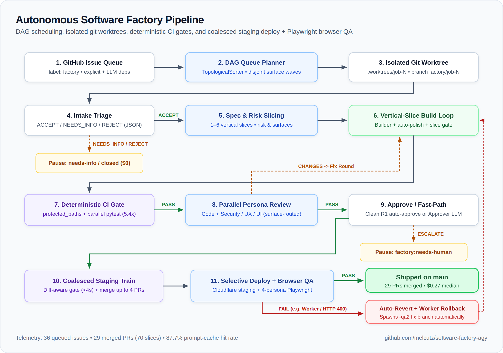
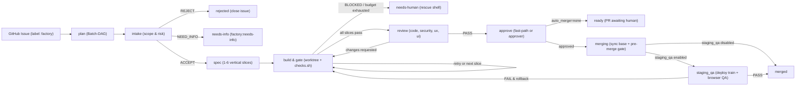
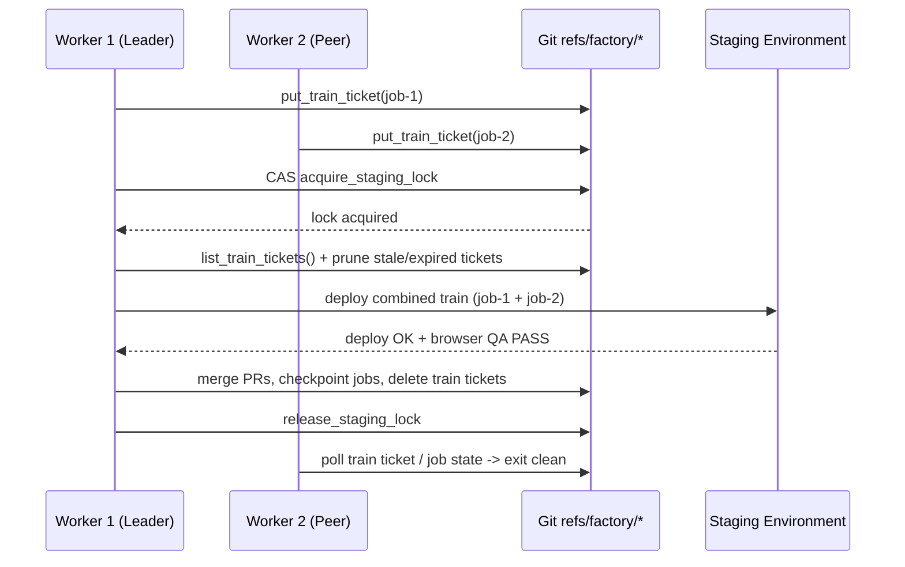

# software-factory-agy

[](https://buy.stripe.com/eVq6oI94c1SL5ne37i4Vy01)

`software-factory-agy` (`v0.3.0`) is a self-contained, zero-central-server autonomous issue-to-PR software factory built on Google Antigravity (`agy`) and the Python 3.10+ standard library.

Given `factory`-labeled GitHub issues, it triages scope and risk, builds a dependency Batch-DAG, writes a technical spec with 1–6 ordered vertical slices, implements and gates each slice in an isolated git worktree, runs parallel specialist reviews, and auto-merges or stages PRs—either on a single machine (`factory run`) or across a **durable multi-machine fleet** (`factory worker --all`) coordinated through Git refs (`refs/factory/*`) and [`herdr-core` (`hc`) + `herdr-app`](https://herdr.dev/).

*(Looking for the simpler `v0.1.0` single-machine baseline? Check out the [`v0.1.0` release](https://github.com/melcutz/software-factory-agy/releases/tag/v0.1.0).)*



---

## Key Features

- **Central Multi-Repo CLI (`factory`):** Install once (`pip install -e .`) and drive any repository with `--repo <path>` or all registered repositories via `--all` (`~/.config/factory/repos.json`).
- **End-to-End Autonomous Pipeline:** `plan` (Batch-DAG) → `intake` → `spec` (1–6 vertical slices) → `build & gate` → `review` (parallel code, security, UX, UI) → `approve` → `merging` → optional `staging_qa` deploy train.
- **Zero-Central-Server Multi-Machine Coordination (`refs/factory/*`):** Atomic `--force-with-lease` Compare-And-Swap job leases, worker heartbeats (`360s` TTL + `60s` skew buffer), slice-level crash checkpoints, distributed staging locks, and shared DAG caching—no coordinator daemon or database required.
- **`herdr-core` (`hc`) & `herdr-app` Visibility:** Workers emit native **OSC 7501** status sequences (`working`, `idle`, `done`, `blocked`) and spawn job workers via `hc run --bg`, surfacing all local and remote jobs live in `herdr-app`'s Agents sidebar with one-click **peek** and `needs-human` rescue shells. Works cleanly in plain terminals too when `$HC_TERMINAL_ID` is unset.
- **Global Kill Switch & Polite Pause:** `factory halt` / `factory resume` stops the entire fleet cleanly at the last completed slice without burning retries or escalating to `needs-human`; `factory pause` / `factory unpause` controls claims on a single machine.
- **Homelab-Polite Resource & Quota Governor:** Probes host CPU load and free RAM (`~/.config/factory/host.json`) before claiming or between slices, paces claims via `ramp_up_delay_sec`, spreads batches evenly across idle machines, and turns LLM `429` / `RESOURCE_EXHAUSTED` errors into shared fleet-wide cooldowns (`refs/factory/quota`).
- **Self-Maintenance & Telemetry:** `factory init` scaffolds target repos, `factory map` maintains `REPO_MAP.md`, `factory learn` distills multi-round failures into `PITFALLS.md`, `factory patrol` files health issues, and `factory stats` / `factory logs` / `factory clean` keep the fleet observable and tidy.

---

## Architecture & Diagrams

### 1. Issue-to-PR Pipeline Lifecycle



### 2. Zero-Server Multi-Machine Fleet Topology

```mermaid
flowchart TD
    subgraph MachineA["Machine A (e.g. Rocket)"]
        WA["factory worker --all"]
        HA["~/.config/factory/host.json"]
        RA["~/.config/factory/repos.json"]
        HCA["hc child terminals + OSC 7501"]
        WA --- HA
        WA --- RA
        WA --> HCA
    end

    subgraph MachineB["Machine B (e.g. Base)"]
        WB["factory worker --all"]
        HB["~/.config/factory/host.json"]
        RB["~/.config/factory/repos.json"]
        HCB["hc child terminals + OSC 7501"]
        WB --- HB
        WB --- RB
        WB --> HCB
    end

    subgraph GitHub["GitHub Origin (No Central Server)"]
        Issues["Issues & PRs (gh CLI)"]
        RefsJobs["refs/factory/jobs/* (CAS leases & state)"]
        RefsWorkers["refs/factory/workers/* (heartbeats)"]
        RefsDag["refs/factory/dag/* (cached Batch-DAG)"]
        RefsTrain["refs/factory/train/* & locks/staging"]
        RefsControl["refs/factory/control & quota"]
    end

    WA <-->|poll & PRs| Issues
    WB <-->|poll & PRs| Issues
    WA <-->|CAS push/fetch| RefsJobs
    WB <-->|CAS push/fetch| RefsJobs
    WA <-->|heartbeat| RefsWorkers
    WB <-->|heartbeat| RefsWorkers
    WA <-->|cache| RefsDag
    WB <-->|cache| RefsDag
    WA <-->|deploy train| RefsTrain
    WB <-->|deploy train| RefsTrain
    WA <-->|halt / 429 cooldown| RefsControl
    WB <-->|halt / 429 cooldown| RefsControl
```



### 3. Distributed Staging Train & Lease Safety



---

## Requirements

- **Python 3.10+** (standard library only; zero third-party runtime packages)
- **Git** with a GitHub `origin` remote
- **GitHub CLI (`gh`)** authenticated (`gh auth status`) with push and PR permissions *(use `gh >= 2.67` to avoid deprecated Projects classic `projectCards` GraphQL errors on `gh pr edit`)*
- **Antigravity CLI (`agy`)** installed and authenticated on `PATH`
- **Optional (for multi-machine desktop/SSH visibility):** [`herdr-app` / `herdr-core` (`hc`)](https://herdr.dev/) on Linux, macOS, or Windows/WSL2

---

## Quickstart (5 Minutes)

### 1. Install the `factory` CLI

```bash
git clone https://github.com/melcutz/software-factory-agy.git
cd software-factory-agy
pip install -e .
# On Ubuntu 24.04+ / externally managed Python:
# python3 -m pip install --user --break-system-packages --no-deps -e .
```

### 2. Prepare a Target Repository

Run `factory init` inside your target repository (or configure the files manually):

```bash
cd /path/to/your-repo
factory init
```

Then:
1. Customize `factory/config.json` (see [Configuration](#configuration)) and `factory/checks.sh` (your non-interactive test/lint/typecheck suite; `chmod +x factory/checks.sh`).
2. Ensure `.gitignore` ignores runtime state:
   ```gitignore
   /factory/jobs/*
   !/factory/jobs/.gitkeep
   /.worktrees/
   ```
3. Create GitHub labels and verify prerequisites:
   ```bash
   gh label create "factory" --color "0E8A16" --description "Queued for autonomous software factory" --force
   gh label create "factory:needs-info" --color "FBCA04" --description "Waiting for issue clarification" --force
   gh label create "factory:needs-human" --color "D93F0B" --description "Escalated for human review" --force

   factory doctor --repo /path/to/your-repo
   ```

### 3. Run Single-Machine or Multi-Machine

**Single-machine (one-shot drain):**
```bash
factory plan --repo /path/to/your-repo        # dry-run Batch-DAG
factory run --repo /path/to/your-repo         # drain queued issues
factory run --repo /path/to/your-repo 42 43   # run specific issues
factory status --repo /path/to/your-repo      # check progress, machine, cost, PRs
```

**Multi-machine durable fleet (with `herdr-core` / `herdr-app`):**
```bash
# Register your target repos once in ~/.config/factory/repos.json:
# ["~/work/repo-a", "~/work/repo-b"]

# Start a durable worker inside hc / herdr-app on each machine:
hc run --bg --name factory-worker -- factory worker --all

# Or wake all machines registered in `hc machine ls` from one laptop:
factory fleet wake

# Inspect fleet status or halt/resume everything at once:
factory status --all
factory halt --reason "maintenance"
factory resume
```

See [INSTALL.md](INSTALL.md) for the complete step-by-step setup guide (including `~/.config/factory/host.json`, `hc machine` setup, and staging QA hooks).

---

## How It Works

- **Smart Batch-DAG (`plan`):** Inspects open `factory`-labeled issues, parses explicit `Depends on #N` links and predicted file/surface overlaps, and groups independent work to run in parallel while serializing dependent issues.
- **Vertical Slices (`spec` & `build`):** Breaks each accepted issue into 1–6 vertical slices. Each slice is implemented in an isolated git worktree (`.worktrees/job-<n>`), verified deterministically by `factory/checks.sh` (`FACTORY_GATE_SCOPE=slice|full`), and checkpointed to Git.
- **Protected Paths:** Changes to `protected_paths` (e.g. `factory/`, `.agents/`, `.github/`) are rejected by the deterministic gate so autonomous jobs cannot weaken their own guardrails.
- **Escalation & Resume (`needs-human`):** If a job exhausts its retry budget or hits `BLOCKED`, it transitions to `needs-human`, comments on the issue, swaps the label to `factory:needs-human`, emits OSC 7501 `state=blocked:kind=question`, and leaves an interactive rescue shell in `.worktrees/job-<n>`. Re-applying the `factory` label resumes from the saved checkpoint.

---

## CLI Reference

| Command | Description |
|---|---|
| `factory init` | Scaffold `factory/config.json`, `checks.sh`, `REPO_MAP.md`, and `.gitignore` |
| `factory doctor` | Validate Python, `git`, `gh`, `agy`, `config.json`, `checks.sh`, and `.gitignore` |
| `factory queue` | List open eligible issues in the queue |
| `factory plan` | Dry-run Smart Batch triage and print the planned Batch-DAG |
| `factory run [n ...]` | Drain open `factory`-labeled issues or process specific issue number(s) |
| `factory worker [--once]` | Run continuous competing-consumer worker loop (`--repo` or `--all`) |
| `factory status [job-id]` | Show fleet banner, active machines, job table (`MACHINE`, slices, cost, PR), or JSON for `<job-id>` |
| `factory logs <job-id>` | Show failure, gate, and review summary for a job |
| `factory stats` | Show telemetry summary (throughput, rounds, tokens, cost) across factory jobs |
| `factory clean` | Remove worktrees for merged/rejected jobs and prune stale git worktrees |
| `factory map` | Generate `factory/REPO_MAP.md` from tracked repository layout |
| `factory learn` | Distill guardrails from multi-round/QA jobs into `factory/PITFALLS.md` |
| `factory patrol [--dry-run]` | Run repo health sensors and file `factory`-labeled issues |
| `factory gate <job-id>` | Run protected-path and `factory/checks.sh` verification on a worktree |
| `factory halt [--reason TEXT] [--force]` | Globally halt all fleet workers and checkpoint active jobs cleanly |
| `factory resume` | Clear global halt and allow workers to resume |
| `factory pause [--drain]` | Pause new job claims on the current machine |
| `factory unpause` | Resume job claims on the current machine |
| `factory fleet {status,wake,pause,unpause,update,remove} [machine]` | Discover, update, remove, and control peer machines via `hc machine` |
| `factory init-board` | Create a generic `"Factory"` GitHub ProjectV2 board (`Status` + `Priority`) |

---

## Configuration

### Repository Config (`<repo>/factory/config.json`)

Controls concurrency, retry budgets, merge behavior (`"auto_merge": "low" | "all" | "none"`), protected paths, and per-role model selection:

```json
{
  "concurrency": 4,
  "max_rounds": 3,
  "max_slice_retries": 2,
  "agent_timeout_sec": 900,
  "gate_timeout_sec": 600,
  "base_branch": "main",
  "merge_method": "merge",
  "auto_merge": "low",
  "labels": {
    "queue": "factory",
    "needs_info": "factory:needs-info",
    "needs_human": "factory:needs-human"
  },
  "protected_paths": ["factory/", ".agents/", ".github/"],
  "models": {
    "planner": "gemini-3.8-flash-medium",
    "intake": "gemini-3.8-flash-medium",
    "spec_writer": "gemini-4-argon-high",
    "builder": "gemini-4-argon-high",
    "approver": "gemini-4-argon-high",
    "code_low": "gemini-3.6-flash-low",
    "code_medium": "gemini-3.8-flash-low",
    "code_high": "gemini-3.8-flash-medium",
    "security": "gemini-4-argon-high",
    "ux": "gemini-3.8-flash-medium",
    "ui": "gemini-3.6-flash-low"
  }
}
```

### Coder Tiers

Each `models.<role>` entry accepts either a single model string or a list-valued fallback chain tried in order:

- **Model-id prefixes:**
  - `gemini-*` (no prefix) → `agy` provider (`paid` tier)
  - `opencode/*` → OpenCode CLI (`free` tier for `*-free` / `opencode/big-pickle`, else `paid`)
  - `opencode-go/*` → OpenCode Go subscription (`subscription` tier, $0 marginal cost, tokens tracked)
  - `openrouter/*` → OpenRouter via OpenCode (`free` tier for `*:free`, else `paid`)
  - `gpu:*` (e.g. `gpu:jev`) → local GPU MCP server (`local` tier, $0)
- **Fallthrough rules:** Chains advance to the next model on `GpuAbstain`, `QuotaExhaustedError` (after recording the cooldown), active cooldowns in `refs/factory/quota`, `AgentExecutionError`, or timeouts. Chains **abort immediately** (never fall through) on `JobHaltedError`, `LeaseLostError`, `abort_check`, or `"illegally moved HEAD"`.
- **GPU abstain-only rules:** `gpu:` is only allowed in `intake`, `approver`, and `planner` (`config.json` validation rejects it elsewhere). It never escalates or rejects — it only fast-paths high-confidence `ACCEPT` (`intake`), clean low-risk round-1 `APPROVE` (`approver`), or `<= 1` issue (`planner`), and abstains otherwise.
- **Cooldown buckets:** `opencode/*-free` & `opencode/big-pickle` share `opencode-free` (3h); `openrouter/*:free` shares `openrouter-free` (3h); `opencode-go/*` shares `opencode-go` (24h); `gpu:*` uses `gpu`; Gemini models normalize to base model (e.g. `gemini-4-argon`).
- **Provider timeouts & pricing:** Configured via `provider_timeouts` (`agy: null`, `opencode: 1800`, `opencode-go: 1800`, `openrouter: 1200`, `gpu: 60`) and `model_pricing` (Gemini 4 Hydrogen `1.50/7.50`, Argon & Carbon `2.00/10.00` per M tokens; free/local/subscription `$0` marginal cost). `factory stats` breaks down calls, tokens, and cost by tier and provider.
- **OpenCode binary & `factory doctor`:** Workers prepend `~/.opencode/bin` and `~/.local/bin` to `PATH`. `factory doctor` verifies `opencode --version` when any chain uses `opencode`/`openrouter`/`opencode-go` (fails if missing), and checks `gpu.mcp_url` `local_gpu_status` (`WARN` only if unreachable or `minicpm5` is not installed).

### Machine Config (`~/.config/factory/host.json`)

Controls per-machine concurrency and resource-governor thresholds (restart the worker after editing):

```json
{
  "machine_id": "Rocket",
  "max_workers": 6,
  "min_free_ram_gb": 2.0,
  "max_cpu_load_pct": 85.0,
  "ramp_up_delay_sec": 20.0,
  "poll_interval_sec": 45.0
}
```

> **Note:** Effective fleet concurrency for a repository is bounded by `min(repo.concurrency, sum(host.max_workers))`.

---

## Repository Layout

```text
.agents/skills/factory/SKILL.md   Antigravity slash-command skill definition
factory/
  cli.py                          Central CLI entrypoint (`factory`)
  bin/factory                     Repo-local wrapper script
  config.json                     Default runtime and model routing configuration
  checks.sh                       Verification gate script
  agents/                         Role prompts (planner, intake, spec-writer, builder, reviewers, approver)
  lib/
    agy_runner.py                 Headless agy runner, idle watchdog, setsid reaping, 429 QuotaExhaustedError
    config.py                     Configuration loader, model pricing, reviewer routing
    fleet.py                      Fleet discovery & control via `hc machine ls` / `hc run --on`
    gate_runner.py                Protected-path diff verification, auto-polish, checks.sh runner
    git_ops.py                    Worktree management, base-branch sync, gh CLI client
    git_state.py                  Git-native refs/factory/* CAS leases, checkpoints, locks, control, quota
    governor.py                   Cross-platform CPU/RAM admission checks & shared quota cooldown helpers
    herdr_bridge.py               herdr-core (hc) background child terminals & OSC 7501 status protocol
    pipeline.py                   End-to-end stage orchestration, staging train, halt/resume
    planner.py                    Dependency DAG builder and cycle-breaking fallback
    project_board.py              GitHub ProjectV2 board creation and stage-to-column sync
    schemas.py                    Stage JSON schemas and Markdown renderers
    staging_qa.py                 Staging QA deploy train coordinator
    state.py                      Thread-safe atomic job.json state machine
    worker.py                     Continuous spread-first worker loop & _exec-job runner
tests/                            Unit and end-to-end pytest suite
```

## Development

Run the full verification suite:

```bash
./factory/checks.sh
# or:
pytest
```

## License

Released under the [MIT License](LICENSE).
