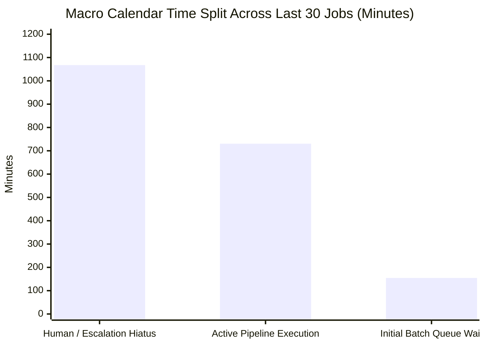
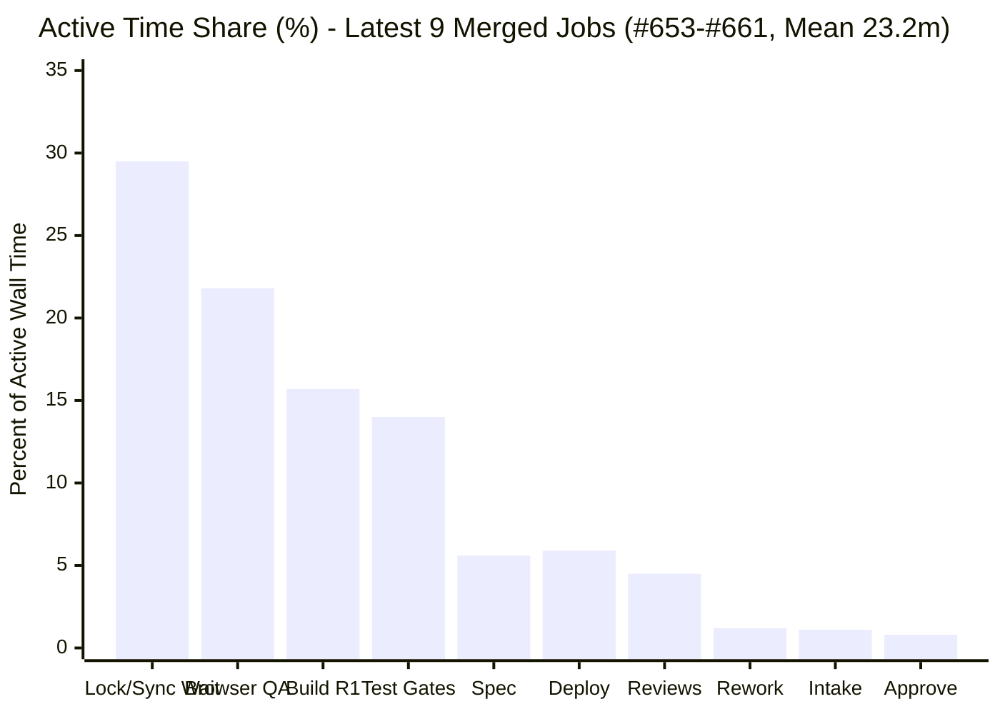

# Factory Last-30-Jobs Time, Bottleneck & Tuning Report

**Window analyzed:** `2026-11-15 20:01 UTC` -> `2026-11-17 04:30 UTC` across `worker-a` + `worker-b`
**Cohort:** Last **30 jobs** across `example-app` (24), `software-factory-agy` (5), and `example-site` (1)
**Outcomes:** **25 merged (`83.3%`)** -- **18 in 1 round (`72%` of merges)**, 4 in R2, 2 in R3, 1 in R4 | **4 rejected/superseded** | **1 `needs-human`** (`#640`, external Cloudflare Speed Brain setting)
**Spend & Tokens:** **`$27.83` total** (**`$0.62` median** per merged job, `$0.93` mean) | **`17.64M` non-cache tokens** + **`113.39M` cached tokens (`86.5%` cache hit rate)**

> [!IMPORTANT]
> **Headline Takeaway:** Writing code (`builder` Round 1) takes a median of **only `3.1 minutes` (`12-16%` of active job time)**. Over **70% of active wall-clock time** is spent *after* the code is written -- inside **single-threaded staging lock / merge-train wait (`30-38%`)**, **Playwright browser QA (`17-22%`)**, **repeated `checks.sh` runs (`13-14%`)**, and **Cloudflare deploys (`6%`)**.

---

## 1. Macro Wall-Clock Split (All 30 Jobs = `32.54` Job-Hours)

Raw elapsed time (`updated - created` = `1,952.4m`) mixes active compute with idle waiting. Separating gaps `>15m` and pre-intake queue wait shows where calendar time actually went:

| Bucket | Total Minutes | Share | Why It Happened |
| :--- | ---: | ---: | :--- |
| **Human / Offline Hiatus (`>15m` gaps)** | `1,067.5m` | `54.7%` | Dominated by `#637` (`425m`) and `#639` (`454m`) sitting in `needs-human` overnight while `worker-b` lacked Playwright/Chromium (now fixed + checked by `factory doctor`), plus `job-2` (`59m`). |
| **Active Machine Execution** | `730.4m` | `37.4%` | Actual end-to-end work from `intake` through `merged` (**median `20.8m`** across all 25 merged jobs; **`20.1m` median** on the latest 9 `example-app` jobs `#653-#661`). |
| **Initial Queue Wait (`created -> intake`)** | `154.5m` | `7.9%` | Legacy `factory run` created `queued` stubs upfront (`job-146` waited `95m`, `job-619` `51m`, `job-2` `29.5m`). Under the competing-consumer `factory worker` daemon, `created -> intake` is now **`7-8s`**. |

---

## 2. Where Active Execution Time Goes (Exact Stage Decomposition)

Beginning with job `#10` (`software-factory-agy:job-12`), every job records exact `gate_duration_seconds` and `deploy_duration_seconds` alongside per-call LLM telemetry (`logs/*.json`). Across the **20 active instrumented jobs (`#10-#30`, `514.8m` active)** and the **latest 9 clean `example-app` jobs (`#653-#661`, `209.0m` active, 9/9 merged)**:

| Pipeline Component | Share (`#10-#30`) | Share (`#653-#661`) | Median Call / Stage | P90 Stage | Root Cause / Why It Takes This Long |
| :--- | ---: | ---: | ---: | ---: | :--- |
| **1. Staging Lock, Merge Sync & Failover Wait** | **`38.2%`** (`196.8m`) | **`29.5%`** (`6.8m`/job) | `6.5m` | `21.0m` | Only **1 shared staging environment** (`staging.example-app.com`) exists behind `refs/factory/staging-lock` ([pipeline.py](../factory/lib/pipeline.py)). Concurrent PRs queue single-file behind the leader's `deploy + browser_qa` (`#653` waited `12.0m`, `#659` waited `13.0m`). Also included `37.1m` of duplicate cross-host reruns before the `renew_job_lease` fix (`51069c7a`). |
| **2. Staging Browser QA (`qa` + Playwright)** | **`17.3%`** (`89.0m`) | **`21.8%`** (`5.1m`/job) | `3.3m` | `8.3m` | `example-app/factory/agents/qa.md` mandates full Playwright Chromium login, `/library` + reader checks, and screenshots **even on backend-only OAuth/MCP/header PRs** (`#656` took `8.3m`, `#658` took `10.2m`) -- while holding `staging-lock`! |
| **3. Test Gates (`checks.sh`)** | **`12.6%`** (`65.0m`) | **`14.0%`** (`3.2m`/job) | `3.3m` | `5.2m` | Runs **2-3x per job**: final slice full gate (`~1.8-3.0m`) + pre-merge gate (`~1.5-2.2m`) whenever `main` advances while waiting for `staging-lock`. Also recompiles Tailwind CSS (`--minify`) on every gate in `example-app/factory/checks.sh`. |
| **4. Primary Build R1 (`builder`)** | **`12.2%`** (`62.6m`) | **`15.7%`** (`3.6m`/job) | `3.1m` | `5.4m` | Fast single-turn TDD implementation (`gemini-4-hydrogen-medium`); builder runs targeted pytest locally before returning `DONE`. |
| **5. Staging Deploy (Cloudflare)** | **`6.2%`** (`32.1m`) | **`5.9%`** (`1.4m`/job) | `83s` | `168s` | `wrangler deploy` (`--web-only --skip-migrations` saves D1 time), but almost always deploys `train_size=1` because `coalesce_window_sec: 15` is narrower than job arrival stagger. |
| **6. Spec Writer (`spec_writer`)** | **`5.3%`** (`27.2m`) | **`5.6%`** (`1.3m`/job) | `72s` | `130s` | Reads repo files to draft `spec.md` even when well-written `factory-inbox` issues already cite exact files and line numbers. |
| **7. Parallel Reviews (`code`/`sec`/`ui`/`ux`)** | **`3.4%`** (`17.3m`) | **`4.5%`** (`1.0m`/job) | `36s` | `93s` | Wall time equals the **slowest parallel reviewer** in the round (almost always `security` on `gemini-4-argon-medium` at `71.6s` median). |
| **8. Rework / Retry Build (R2+)** | **`2.9%`** (`15.1m`) | **`1.2%`** (`0.3m`/job) | `61s` | `175s` | Low when host deps are healthy: in `#653-#661`, only `#657` needed a QA fix round (`56s` + `172s`) and `#661` needed 1 slice-gate retry (`58s`). |
| **9. Approver (`approver`)** | **`1.0%`** (`5.1m`) | **`0.8%`** (`0.2m`/job) | `31s` | `46s` | Triggered on `10/20` jobs (`gemini-4-argon-medium`) whenever any reviewer left a non-blocking `low` nit; approved **`10/10` (`100%`)**. |
| **10. Intake (`intake`)** | **`0.9%`** (`4.6m`) | **`1.1%`** (`0.3m`/job) | `13s` | `18s` | Triage & risk/surface tagging on `gemini-4-hydrogen-medium`. |

---

## 3. Deep-Dive Findings: Signal vs. Ceremony

### A. Reviewers Have a `98.9%` Pass Rate -- and `security` (`argon-medium`) Is a `7x` Latency Bottleneck
Across all 30 jobs, the factory executed **88 reviewer LLM calls**:

| Reviewer Role | Configured Model (`example-app`) | Calls | Median | P90 | Slowest in Round | `PASS` | `FAIL` |
| :--- | :--- | ---: | ---: | ---: | :--- | ---: | ---: |
| `review-code` | `gemini-4-hydrogen-low` (`medium` on high risk) | 35 | `10.2s` | `29.3s` | 1x | 34 | **1** (`job-2`) |
| `review-security` | `gemini-4-argon-medium` | 11 | **`71.6s`** | **`96.4s`** | **10 / 11 (`91%`)** | 11 | **0** |
| `review-ux` | `gemini-4-hydrogen-medium` | 21 | `17.1s` | `27.2s` | 20 / 21 (non-sec) | 21 | **0** |
| `review-ui` | `gemini-4-hydrogen-low` | 21 | `7.0s` | `9.3s` | 0x | 21 | **0** |
| `approver` | `gemini-4-argon-medium` | 10 | `30.5s` | `45.8s` | (sequential after review) | 10 | **0** |

- **Why this matters:** Whenever `intake` tags `"security"` (any auth, OAuth, MCP, entitlement, or header PR), `review-security` runs on `gemini-4-argon-medium` (`72s` median vs `10s` for `code`), adding **+1 minute** of wall time with **0 catches in 11 runs**, and if any reviewer adds a minor non-blocking note, `approver` (`argon-medium`) adds **another +31-46s** sequential step (`10/10` rubber-stamped `APPROVED`).

### B. Staging QA Caught Real Bugs -- But Over-Tests Backend PRs Inside a Global Lock
- **Value proven:** On `job-657` (MCP CORS & OAuth metadata), pre-merge pytest passed, PR #667 deployed to staging, and `browser_qa` **caught a real live staging regression**, auto-reverted `main`, fed reproduction steps to Round 2, and verified PR #670 cleanly.
- **Why it bottlenecks throughput:** Because `staging-lock` is global per repo, `deploy (1.4m) + browser_qa (5.1m mean) = ~6.5m` caps **maximum fleet merge throughput on `example-app` to ~9 PRs/hour** regardless of whether you have 2 machines or 10 machines! Worse, every PR waiting on `staging-lock` sees `origin/main` advance when the PR ahead of it merges, forcing it to re-run `pre-merge-gate` (`+1.5-2.2m`) before its own deploy.

### C. Why Worker Claiming Staggered by ~65-85s Per Issue
- Both `~/.config/factory/host.json` files (`worker-a` and `worker-b`) set `"poll_interval_sec": 45.0` and `"ramp_up_delay_sec": 20.0`.
- In [worker.py](../factory/lib/worker.py), `run_worker()` claims at most **1 issue per loop** and then unconditionally sleeps `poll_interval_sec` (`45s`) + runs queue planning (`~20s`) before claiming the next issue -- even when 5 more issues are ready and slots are free (`02:27:23 -> 02:28:47` on `#653 -> #656`).

---

## 4. Per-Job Summary Table (All 30 Jobs, Chronological)

| # | Job (`repo:id`) | Stage | Hosts | Rnd / QA | Slices | Risk | Active Wall | Wait / Hiatus | Build LLM | Gates | Deploy + QA | Lock / Sync | Cost |
| ---: | :--- | :--- | :--- | :---: | :---: | :---: | ---: | ---: | ---: | ---: | ---: | ---: | ---: |
| 1 | `example-site:job-146` | `merged` | worker-a | 1 / 0 | 1/1 | low | `7.1m` | `95.1m` | `4.5m` | n/a* | `0.0m` | `0.3m` | `$0.30` |
| 2 | `example-app:job-617` | `merged` | worker-a | 1 / 0 | 1/1 | low | `26.6m` | `0.1m` | `9.8m` | n/a* | `1.9m` | `13.3m` | `$0.62` |
| 3 | `example-app:job-618` | `merged` | worker-a | 1 / 0 | 2/2 | med | `40.5m` | `0.1m` | `11.6m` | n/a* | `2.6m` | `24.1m` | `$0.83` |
| 4 | `example-app:job-619` | `merged` | worker-a | 1 / 0 | 1/1 | low | `10.3m` | `50.9m` | `6.1m` | n/a* | `2.1m` | `0.4m` | `$0.45` |
| 5 | `example-app:job-620` | `merged` | worker-a | 1 / 0 | 1/1 | low | `17.6m` | `0.1m` | `3.9m` | n/a* | `1.9m` | `10.3m` | `$0.37` |
| 6 | `software-factory-agy:job-1` | `merged` | worker-a | 1 / 0 | 2/2 | high | `29.3m` | `0.1m` | `25.1m` | n/a* | `0.0m` | `0.1m` | `$3.26` |
| 7 | `software-factory-agy:job-2` | `merged` | worker-b,worker-a | 2 / 0 | 2/2 | high | `52.4m` | `88.5m` | `32.5m` | n/a* | `0.0m` | `16.9m` | `$7.90` |
| 8 | `software-factory-agy:job-4` | `rejected` | worker-b | 1 / 0 | 0/0 | low | `0.0m` | `0.0m` | `0.0m` | `0.0m` | `0.0m` | `0.0m` | `$0.00` |
| 9 | `software-factory-agy:job-3` | `rejected` | worker-b | 1 / 0 | 1/2 | med | `7.7m` | `0.0m` | `6.7m` | n/a* | `0.0m` | `0.0m` | `$0.97` |
| 10 | `software-factory-agy:job-12` | `merged` | worker-a | 1 / 0 | 1/1 | low | `14.1m` | `0.1m` | `4.7m` | `0.9m` | `0.0m` | `6.6m` | `$0.42` |
| 11 | `example-app:job-626` | `merged` | worker-b,worker-a | 2 / 0 | 1/1 | low | `10.1m` | `18.1m` | `2.6m` | `1.6m` | `1.9m` | `2.9m` | `$0.33` |
| 12 | `example-app:job-630` | `rejected` | worker-b,worker-a | 2 / 0 | 2/2 | med | `32.2m` | `0.1m` | `8.5m` | `3.7m` | `0.0m` | `17.9m` | `$0.81` |
| 13 | `example-app:job-627` | `merged` | worker-b,worker-a | 3 / 0 | 1/1 | low | `29.7m` | `17.3m` | `3.9m` | `3.2m` | `4.0m` | `17.3m` | `$0.44` |
| 14 | `example-app:job-625` | `rejected` | worker-a | 1 / 0 | 0/0 | low | `0.3m` | `0.1m` | `0.0m` | `0.0m` | `0.0m` | `0.2m` | `$0.01` |
| 15 | `example-app:job-629` | `merged` | worker-a | 1 / 0 | 1/1 | low | `11.2m` | `0.1m` | `3.3m` | `1.6m` | `3.9m` | `1.4m` | `$0.39` |
| 16 | `example-app:job-628` | `merged` | worker-b,worker-a | 3 / 0 | 1/1 | low | `35.8m` | `0.1m` | `3.8m` | `3.4m` | `3.8m` | `23.6m` | `$0.40` |
| 17 | `example-app:job-636` | `merged` | worker-b,worker-a | 1 / 0 | 1/1 | low | `55.1m` | `0.1m` | `3.9m` | `3.9m` | `5.3m` | `40.4m` | `$0.63` |
| 18 | `example-app:job-637` | `merged` | worker-b,worker-a | 2 / 1 | 1/1 | low | `56.9m` | `425.4m` | `8.2m` | `5.2m` | `12.6m` | `28.5m` | `$0.55` |
| 19 | `example-app:job-639` | `merged` | worker-b,worker-a | 4 / 1 | 2/2 | low | `46.8m` | `454.5m` | `11.5m` | `5.7m` | `12.3m` | `14.1m` | `$1.34` |
| 20 | `example-app:job-638` | `merged` | worker-b,worker-a | 1 / 0 | 1/1 | med | `19.4m` | `0.1m` | `5.1m` | `1.8m` | `4.1m` | `6.6m` | `$0.49` |
| 21 | `example-app:job-640` | `needs-human` | worker-b,worker-a | 3 / 3 | 1/1 | low | `31.1m` | `0.1m` | `3.6m` | `4.6m` | `9.2m` | `12.1m` | `$0.53` |
| 22 | `example-app:job-653` | `merged` | worker-a | 1 / 0 | 1/1 | med | `27.9m` | `0.1m` | `4.8m` | `2.8m` | `5.6m` | `11.4m` | `$0.80` |
| 23 | `example-app:job-656` | `merged` | worker-a | 1 / 0 | 2/2 | high | `20.1m` | `0.1m` | `3.4m` | `2.9m` | `9.8m` | `1.8m` | `$0.69` |
| 24 | `example-app:job-659` | `merged` | worker-a | 1 / 0 | 1/1 | low | `20.1m` | `0.1m` | `1.6m` | `1.8m` | `3.6m` | `12.2m` | `$0.26` |
| 25 | `example-app:job-654` | `merged` | worker-a | 1 / 0 | 1/1 | med | `13.7m` | `0.1m` | `3.1m` | `1.7m` | `3.2m` | `3.0m` | `$0.69` |
| 26 | `example-app:job-655` | `merged` | worker-a | 1 / 0 | 1/1 | med | `15.7m` | `0.1m` | `5.0m` | `1.5m` | `5.6m` | `1.7m` | `$0.70` |
| 27 | `example-app:job-657` | `merged` | worker-a | 2 / 1 | 2/2 | high | `49.6m` | `0.1m` | `8.6m` | `4.4m` | `10.1m` | `21.0m` | `$1.70` |
| 28 | `example-app:job-660` | `merged` | worker-a | 1 / 0 | 1/1 | med | `20.8m` | `0.1m` | `5.3m` | `3.4m` | `4.8m` | `4.7m` | `$0.72` |
| 29 | `example-app:job-658` | `merged` | worker-b,worker-a | 1 / 0 | 1/1 | high | `22.7m` | `37.7m` | `2.3m` | `6.2m` | `11.6m` | `0.1m` | `$0.82` |
| 30 | `example-app:job-661` | `merged` | worker-b,worker-a | 1 / 0 | 1/1 | med | `18.7m` | `19.4m` | `1.7m` | `4.6m` | `4.4m` | `5.9m` | `$0.47` |

*\*Jobs `#1-#9` ran prior to `job-12` adding `metrics.gate_duration_seconds`; their `checks.sh` runtime is folded into `Lock / Sync`.*

---

## 5. How You Can Tweak This Further (Actionable Levers)

Depending on whether you want **maximum velocity** or **maximum staging safety**, here are the highest-leverage knobs ranked by time saved per job:

### Lever 1 -- Unblock the Staging Train & Right-Size Browser QA *(Saves ~`5-9 min/job` under concurrent load)*
1. **Increase `staging_qa.coalesce_window_sec` from `15` -> `60` (or `90`)** in `example-app/factory/config.json`:
   - Today, `15s` almost never catches sibling PRs (`train_size=1` on 100% of `#653-#661`), so 4 PRs pay `4 * (83s deploy + 5m QA) = 26m` serially. Batching 2-4 PRs into one train deploy + one QA run cuts staging lock contention by **50-70%** AND avoids invalidating `verified_gate_sha` on sibling PRs.
2. **Add an API/HTTP Fast-Mode to Staging QA for Non-UI PRs** (`example-app/factory/agents/qa.md` or `staging_qa` config):
   - When `surfaces` does **not** include `"ui"` (e.g., MCP JSON-RPC, OAuth headers, rate limits, entitlements), skip launching headless Chromium / `/library` / screenshots and verify the live staging HTTP endpoints + `/health` directly via Python `urllib`/`httpx` (`~35-50s` instead of `5-10m`).

### Lever 2 -- Speed Up `example-app/factory/checks.sh` *(Saves ~`1.5-2.5 min/job`)*
1. **Conditionalize `[6/8] Tailwind CSS freshness check`** in `example-app/factory/checks.sh`:
   - Only invoke the `tailwindcss --minify` binary when `git diff --name-only origin/main...HEAD` touches `templates/`, `static/`, `tailwind*`, or frontend `.js` files.
2. **Narrow `FACTORY_GATE_SCOPE=slice` test matching** in `example-app/factory/checks.sh`:
   - Right now, editing `src/example_app/auth/routes.py` adds `pkg_dirs={"tests/auth"}` **plus** `tests/**/test_*auth*.py` across the whole repo, turning a `slice` gate (and `select_pre_merge_gate_scope == "slice"`) into a near-full suite run. Mapping `src/example_app/<pkg>/<mod>.py` primarily to `tests/<pkg>/test_<mod>*.py` + `tests/test_<mod>*.py` drops `slice` and non-conflicting pre-merge gates from `~110s` to `~15-20s`.

### Lever 3 -- Trim High-Latency / Low-Signal LLM Calls *(Saves ~`1.5-2.5 min/job` + ~`25-30%` cost)*
1. **Switch `models.security` from `gemini-4-argon-medium` -> `gemini-4-hydrogen-medium`** (or only escalate `security` to `argon` when `risk == "high"` & `security` surface) in `example-app/factory/config.json`:
   - Cuts security-tagged review rounds from `72s` -> `~18s` (`0/11` failures caught by `argon` so far).
2. **Drop `models.intake` and `models.planner` from `gemini-4-hydrogen-medium` -> `gemini-4-hydrogen-low`:**
   - Cuts pre-claim queue planning from `~35-45s` -> `~10s` and `intake` from `15s` -> `~6s`.
3. **Relax `auto_approve_clean` to skip `approver` whenever all reviewers return `PASS` with zero `high`/`blocking` findings** ([pipeline.py](../factory/lib/pipeline.py)):
   - Eliminates the sequential `31-46s` `argon-medium` `approver` call that rubber-stamped `10/10` PRs with minor `low` nits.

### Lever 4 -- Faster Multi-Issue Ramp-Up Across Both Fleet Machines *(Saves `45-65s` per queued issue)*
1. **Sleep `ramp_up_delay_sec` (not `poll_interval_sec`) when `claimed_any == True`** in [worker.py](../factory/lib/worker.py), and lower `poll_interval_sec` in `~/.config/factory/host.json` from `45.0` -> `20.0` (`ramp_up_delay_sec: 10.0`) on both `worker-a` and `worker-b`:
   - Both machines immediately fan out across a 6-issue batch within ~30s instead of dripping 1 claim every ~65-85s.

> [!TIP]
> **Projected Combined Impact:** Applying Levers 1-4 brings a typical `example-app` PR from **`~20-23 minutes` active wall-clock down to `~9-12 minutes`**, while **doubling to tripling batch merge throughput** (`~9 PRs/hr -> ~20-25 PRs/hr`) across `worker-a` + `worker-b`.
