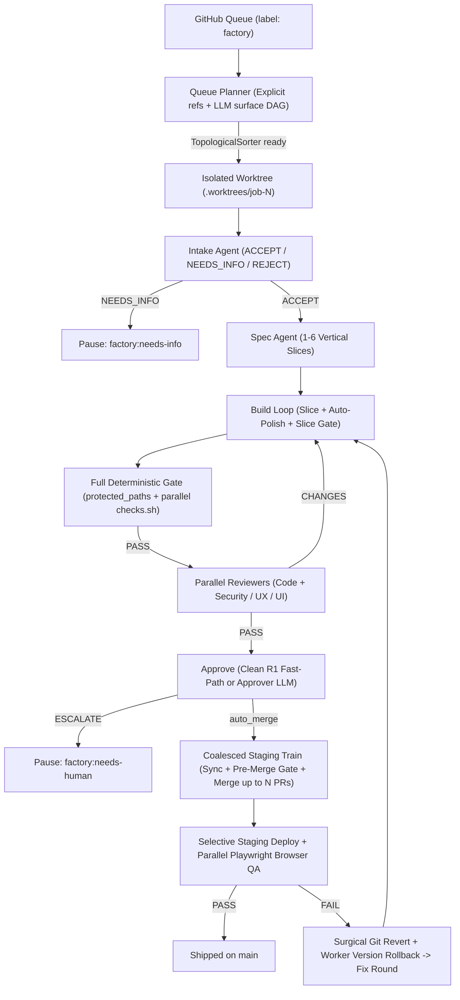
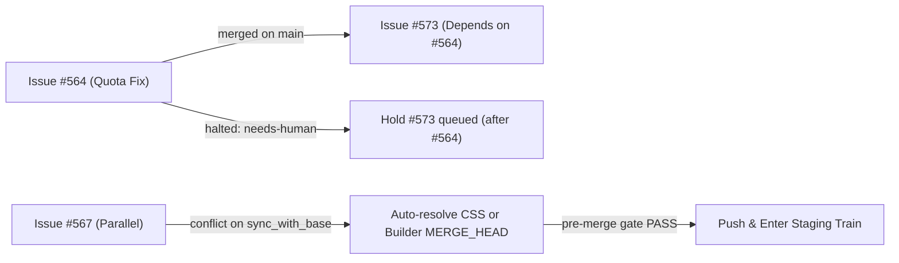

# Building an Autonomous Software Factory: Architecture, War Stories, and Hard-Won Lessons

If you use AI coding agents every day, you eventually hit the same bottleneck: **you are still the orchestrator.** You open a session, paste an issue, wait for a plan, nudge it when tests fail, ask a second prompt to review the diff, resolve the merge conflict, and babysit the PR. It works for one task at a time, but it does not scale.

We wanted something different: **minimum human effort to reliably ship high-quality code for real, multi-file features.** You file a GitHub issue, slap a `factory` label on it, and walk away. Clean changes should spec, build, test, review, merge, deploy to staging, verify themselves in a real browser, and either stay live or automatically roll back if anything regresses. Ambiguous issues should pause and ask a concrete question instead of guessing.

That goal became [`software-factory`](https://github.com/melcutz/software-factory) (formerly `software-factory-agy`), an MIT-licensed autonomous software factory originally powered by Google Antigravity (`agy`), battle-tested on our product (`example-site` open core and `example-app`, a multi-tenant Cloudflare Python Workers + D1 SaaS with 3,260+ automated tests).

What surprised us most was **where the time and failures actually lived.** We expected to spend most of our effort tuning prompts and waiting on LLMs. Instead:

- **Two-thirds (`66.6%`) of end-to-end job wall-clock time wasn't spent inside LLMs at all** -- it was spent in serial test gates, Cloudflare Worker bundle builds/deployments, and lock queuing.
- **Right-sizing models per role and leaning on prompt caching (`87.8%` cache hit rate) cut our cost per merged multi-slice PR by ~35x** -- from `$7.03-$14.25` on early all-frontier runs down to a **`$0.27` median** across 19 consecutive shipped PRs.
- **The bugs that mattered most couldn't be caught by 3,200+ local unit tests** -- they only surfaced on live Cloudflare Workers staging, where automated Playwright QA + surgical rollback caught real edge-runtime outages before a human ever looked at them.

This is the story of the architecture we built, the telemetry from 36 real production-repo jobs, what broke under load, and what we learned.

---

## What We Set Out to Build

Our design goals were simple and opinionated:

1. **GitHub as the control plane.** Issues are the inbox (`factory` / `factory:queue` label), `factory:needs-info` pauses for human clarification, `factory:needs-human` escalates blockers, and PRs are the output.
2. **Deterministic orchestration, untrusted AI workers.** The AI agents (`intake`, `spec-writer`, `builder`, `reviewer-*`, `approver`, `qa`, `planner`) never control the state machine or touch `factory/` or `.github/`. They run headlessly and return strict JSON matching a schema.
3. **Vertical slices with real gates.** Instead of one giant "implement this whole issue" prompt, features are broken into 1-6 vertical slices, each committed and checked before moving on.
4. **Risk-based routing and live-staging verification.** Simple changes fast-path cleanly; UI or security changes pull in specialized reviewers (`reviewer-ux`, `reviewer-ui`, `reviewer-security`); and merged PRs verify themselves against live staging with automatic git revert + Worker version rollback on regression.

---

## The Architecture

At a high level, `factory run` schedules queued issues as a dependency DAG, drives each issue through an isolated `git worktree` pipeline, and batches approved PRs into a coalesced staging deploy + browser QA train:

Under the hood, four design choices hold the system together:

- **Headless JSON RPCs ([`f7e1a28`](https://github.com/melcutz/software-factory/commit/f7e1a28), [`b797862`](https://github.com/melcutz/software-factory/commit/b797862)):** Every agent is invoked via `agy` in headless JSON mode and validated against `SCHEMAS` in `factory/lib/schemas.py`. The orchestrator renders the human-readable `*.md` artifacts from that JSON, so a chatty model can never corrupt downstream parsing.
- **Atomic state machine ([`ef000ff`](https://github.com/melcutz/software-factory/commit/ef000ff)):** Each job's `job.json` is updated under a file lock via `tempfile.mkstemp` + `os.replace`, with an explicit `TRANSITIONS` graph and `escalated_from` tracking.
- **Worktrees + protected-path enforcement ([`db75973`](https://github.com/melcutz/software-factory/commit/db75973)):** Every job builds in `.worktrees/job-<N>` on branch `factory/job-<N>`. Before any test suite runs, a deterministic gate checks `git diff` against `protected_paths` (`factory/`, `.agents/`, `.github/`, `vendor/`) so an agent can never weaken its own checks.
- **End-to-end test harness ([`5dc762b`](https://github.com/melcutz/software-factory/commit/5dc762b)):** The entire pipeline -- including multi-PR staging trains, git revert conflicts, and Worker rollbacks -- is tested end-to-end with real `git` bare remotes and worktrees paired with fake `gh` and `agy` shims.

---

## By the Numbers: 36 Real Jobs on `example-app`

Pointing the factory at `example-app` (a multi-tenant FastAPI + Cloudflare Python Workers + D1 + Queues + Stripe + Workers AI codebase with 8 CI invariant gates and 3,264 tests) gave us hard telemetry across **36 queued GitHub issues** spanning two major waves:

| Metric (`example-app` Factory Telemetry) | Value |
| :--- | :--- |
| **Total issues processed** | **36 jobs** (`29` merged to `main`, `1` rejected at intake, `6` in-flight / queued in Wave 2) |
| **Wave 1 completion rate (`job-516..job-541`)** | **22 / 22 accepted issues merged (`100%`)**, `1` invalid issue rejected at intake in `25.4s` (`$0.00`) |
| **Vertical slices shipped across merged PRs** | **70 slices** (`1` to `5` slices per issue; median `2` slices) |
| **Total tokens processed (`input` + `cache_read` + `output`)** | **217.2M tokens** (`26.5M` uncached input, **`188.2M` cache reads**, `2.5M` output, `1.2M` thinking) |
| **Prompt-cache hit ratio (`cache_read / total_input`)** | **`87.7%`** |
| **Cumulative LLM active turn time (summed across 36 jobs)** | **`10.45 hours`** across 360+ headless agent invocations |
| **Cost per merged PR (early all-frontier baseline, `job-517..518`)** | **`$7.03` - `$14.25`** (`$21.28` for 2 PRs) |
| **Cost per merged PR (right-sized Wave 1, `job-519..537`, 19 PRs)** | **`$0.27` median** (`$0.05` min - `$0.51` max; **`$4.97` total for all 19 PRs combined**) |
| **Median job wall-clock time (Wave 1 -> Wave 2 after gate/train speedups)** | **`52.2 min` -> `18.9 - 22.3 min`** (**~2.5x faster end-to-end**) |
| **Full 8-step CI gate (`3,264` tests) duration** | **`~6m 30s` -> `1m 12.5s`** (**5.4x faster** via `pytest-xdist` + adaptive worker budget) |
| **Post-approve (`merging` + `staging_qa`) median wall-clock** | **`24.4 min` -> `3.0 - 4.9 min`** (**5x - 8x faster** via selective flags + coalesced train) |

A snapshot of representative jobs from the `example-app` logs tells the story of how the system evolved:

| Job | Feature / Fix | Slices | Rounds / QA | LLM Time | Wall Time | Cache Tokens | Cost | Outcome & Lesson |
| :--- | :--- | :---: | :---: | :---: | :---: | :---: | :---: | :--- |
| `job-518` | High-risk security/auth change (all-Argon baseline) | 2/2 | R1 / QA0 | `82.1m` | `93.6m` | `33.2M` | `$14.25` | Merged (#542), proved all-frontier tiering was overkill |
| `job-519` | 5-slice high-risk feature (first role-tiered run) | 5/5 | R1 / QA0 | `26.1m` | `69.7m` | `5.0M` | `$0.27` | Merged (#547), **52x cheaper** than `job-518` |
| `job-525` | Bookmark `.html` import size limits | 2/2 | **R2 / QA1** | `29.6m` | `104.4m` | `5.4M` | `$0.51` | **Live Staging QA caught HTTP 400** on 2 MB upload, auto-rolled back & self-healed (#554) |
| `job-527` | Tag merge validation & HTMX UX | 4/4 | **R2 / QA0** | `24.3m` | `54.3m` | `8.3M` | `$0.44` | **`reviewer-ux` caught silent HTMX 400**, fixed in R2 (#552) |
| `job-532` | Medium-risk 2-slice product fix | 2/2 | R1 / QA0 | **`8.6m`** | **`58.4m`** | `2.2M` | `$0.05` | Merged (#557), **85.3% of wall time was non-LLM gates/deploy** |
| `job-541` | Out-of-scope / duplicate queued issue | 0/0 | R0 / QA0 | `0.4m` | `0.5m` | `86K` | `$0.00` | Rejected cleanly at `intake` before touching a worktree |
| `job-566` | Wave 2 2-slice feature (parallel gate + selective deploy) | 2/2 | R1 / QA0 | `9.6m` | **`18.9m`** | `5.2M` | `$1.31` | Merged (#577), post-approve deploy + QA took just **`4.9m`** |
| `job-567` | Wave 2 2-slice feature (fast-path approve + train) | 2/2 | R1 / QA0 | `13.3m` | **`22.3m`** | `4.1M` | `$0.92` | Merged (#578), post-approve deploy + QA took just **`3.0m`** |
| `job-568` | Cut ~900 KB HTML payload bloat via `/static/*.js` | 2/2 | **R3 / QA2** | `34.0m` | `49.9m` active | `18.4M` | `$2.38` | **Merged (#598):** QA1 caught missing `**/*.js` Wrangler glob (#597), reverted, fixed & passed 4-persona QA2 **11.5m later** |

---

## Eleven Hard-Won Lessons from Production

### 1. Most of Your Wall-Clock Time Isn't LLM Inference -- It's Tests, Deployments, and Locks
When Wave 1 felt slow (~50-65 minutes per ticket), our instinct was to blame LLM latency. Then we measured timestamps across the 14 uninterrupted post-tuning Wave 1 jobs (`job-519..job-537`):

- **Median end-to-end job wall-clock:** `52.2 minutes`
- **Median total LLM time across all stages combined (`intake` + `spec` + `build` + `review` + `approve` + `qa`):** **`16.3 minutes` (`33.4%`)**
- **Median non-LLM time (test gates, staging deploys, lock waits):** **`35.9 minutes` (`66.6%`)**

On smaller 2-slice tickets like `job-531` and `job-532`, LLMs accounted for just **`14.7% - 17.2%`** of wall-clock time! Two bottlenecks dominated the other `83%+`:
1. **Serial `checks.sh` gates (`~6m 30s` each):** Running 3,260 pytest tests single-threaded after build slices and again during `pre-merge` sync while holding `repo_lock`.
2. **Serial staging deploys (`24.4 min` median post-approve wall time):** Out of `24.4 minutes` spent after `approve`, the Playwright QA LLM ran for only **`2.9 minutes`**. The other **`21.5 minutes`** went to waiting on the global `.staging.lock`, bundling and deploying two Cloudflare Python Workers (`web` + `ingest`), running D1 migrations, and running post-deploy smoke checks for every single PR one by one.

Once we saw the data, we stopped tweaking prompts and attacked deterministic infrastructure:
- **Adaptive `pytest-xdist` (`--dist loadfile`):** `gate_runner.py` tracks `_ACTIVE_FULL_GATES` and budgets `compute_pytest_workers = min(8, max(2, cpus // active_full_gates))` so 1 gate uses 8 cores while 4 concurrent gates use 2 cores each without thrashing CPU. Full `checks.sh` dropped from **`6m 30s` to `1m 12.5s` (5.4x faster)**.
- **Diff-aware `pre-merge` gate:** When `sync_with_base` merges disjoint upstream changes with zero conflicts and no shared-infra edits (`pyproject.toml`, migrations, `app.py`, `providers.py`, `conftest.py`), `pre-merge` runs `FACTORY_GATE_SCOPE=slice` in **`< 4 seconds`** instead of re-running all 3,264 tests.
- **Selective staging deploy flags:** `plan_staging_deploy()` inspects the git diff -- skipping staging deploy + browser QA entirely for docs/tests-only PRs, and passing `--web-only --skip-migrations` whenever ingest Worker code and D1 SQL migrations are untouched.
- **Coalesced Staging Deploy Train (`StagingTrainCoordinator`):** Instead of serializing 4 ready PRs through 4 back-to-back 12-minute deployments (`~48m`), a thread-safe Leader/Followers coordinator merges up to `max_batch_size` (default `4`, configurable) PRs onto `main`, deploys to Cloudflare staging **once**, and fans out per-PR Playwright QA agents in parallel. If 1 of 4 PRs fails QA, the train attempts a **surgical `git revert`** of just the culprit commit and re-deploys the 3 passing PRs; if the revert conflicts (or if the shared batch deploy itself fails), it rolls back the batch and re-queues innocent PRs at `stage=merging` (`solo=True` on shared infra failures) with **zero `qa_round` penalty and zero extra Builder LLM calls**.

**Takeaway:** Measure wall-clock time vs. active LLM turn duration before optimizing anything. In a real repo with thousands of tests and cloud deployments, systems engineering beats prompt tweaking 5-to-1.

---

### 2. Right-Sizing Models + Prompt Caching Cut PR Cost by 35x (`$14.25` -> `$0.27`)
Our first three `example-app` jobs (`job-516..518`) ran a frontier reasoning model (`gemini-4-argon` high effort) across every stage. `job-518` (a 2-slice auth/security ticket) burned `82 minutes` of model time, `33.2M` cached tokens, and **`$14.25` on a single PR**.

Per-step cost telemetry (`[job-N] stage=... dur=... tokens=... (in=... cache=... out=... think=...) cost=$...`) made the fix obvious:
- **Match model tier to cognitive load:** Keep frontier reasoning where architectural judgment matters (`spec` on complex/high-risk tickets, `security` review, `approver` on `risk == "high"`), and route structured execution (`intake`, vertical-slice `builder`, `code`/`ux`/`ui` review, Playwright `qa`) to fast mid-tier models.
- **Inject a compact `REPO_MAP.md` (~90 lines):** Agents were burning 6-10 turns at the start of every stage running `find` and `grep` just to rediscover directory layout, SPI boundaries, and test conventions. Prepending `factory/REPO_MAP.md` eliminated cold-start exploration turns and maximized prefix sharing (`188.2M` cache-read tokens out of `214.7M` input tokens = **`87.7%` cache hit rate**).
- **Deterministic Round-1 clean auto-approval (`risk != "high"`):** When `round == 1`, `risk != "high"`, `checks.sh` passed, and every routed reviewer returned `PASS` with zero `must_fix`/`should_fix` findings, calling an LLM `approver` to rubber-stamp `APPROVE` is pure latency and cost waste. Skipping the LLM on clean low/medium Round-1 PRs while requiring full `approver` inspection on high-risk or multi-round PRs saved another turn per ticket.

Across the next **19 consecutive merged PRs (`job-519..537`, 49 vertical slices)**, total LLM spend was **`$4.97` combined -- a median of `$0.27` per shipped PR** (as low as `$0.05` on clean 2-slice fixes), with a `100%` merge rate.

**Takeaway:** Log token cache reads and dollar cost per step from day one. Most agent turns are structured execution, not open-ended research -- tier your models accordingly and feed them a static `REPO_MAP.md`.

---

### 3. Local Unit Tests Lie About Edge Runtimes -- Live Staging QA + Auto-Rollback Caught Real Outages
A natural question is: *"If you already have 3,264 unit/integration tests and specialized LLM code reviewers, why bother deploying to live staging and running headless Chromium?"*

Two real `example-app` jobs answered that definitively:

1. **The `1 MiB` Multipart Parser Trap (`job-525`):** `job-525` enforced a `10 MB` bookmark `.html` upload cap on `POST /import`. All 3,200+ local ASGI `TestClient` tests and code reviews passed on Round 1, and PR `#549` merged and deployed to `staging.example-app.com`. Then the Playwright `qa` agent uploaded real `2 MB` and `10.5 MB` `.html` files through the live Cloudflare Worker -- and got back `HTTP 400 {"detail": "There was an error parsing the body"}` (Starlette's `MultiPartParser` default `1 MiB` `max_part_size` was rejecting `2 MB` files before the route handler ever ran!). The factory **automatically `git revert`ed the merge commit on `main`, rolled back both Cloudflare Workers via `wrangler versions deploy`, verified `/health`, spun up `factory/job-525-qa2` with the Playwright failure screenshot and HTTP payload, fixed `max_part_size`, and shipped PR `#554` on QA Round 2** -- zero human touches, `$0.51` total cost.
2. **The Missing Wrangler Bundle Glob (`job-568`):** `job-568` extracted ~900 KB of inline `<script>` tags out of Jinja templates into `/static/base.js`, `/static/library.js`, and `/static/tags.js`. Every local test passed because local Python reads `src/example_app/static/*.js` straight from disk. On live Cloudflare Workers staging, Playwright opened `/` in Chromium, saw `GET /static/base.js -> 404` (`MIME type 'application/json'`, `typeof window.showToast === "undefined"`), and diagnosed the exact root cause in `failure.md`: `apps/web/wrangler.staging.jsonc` `rules[].globs` only listed `["**/*.html", "**/*.sql", "**/*.md", "**/*.css"]` and omitted `"**/*.js"`, so Wrangler stripped all JS files when bundling the Python Worker! Automatically, the factory reverted PR `#597`, rolled back staging Workers, patched the Wrangler globs, passed all 3 reviewers, deployed PR `#598`, verified HTTP 200 `application/javascript` + `immutable` cache headers across 4 Playwright personas on `qa-2`, and merged cleanly -- **just `11.5 minutes` from QA failure to self-healed merge** (`$2.38` total).

**Takeaway:** Local test harnesses don't test build bundlers, CDN/Access headers, Worker packaging globs, or framework parser limits. Closing the loop with live-staging browser QA + automated revert/rollback turns silent production outages into self-healing Round-2 PRs.

---

### 4. Parallel Agents Expose Hidden Repo Coupling (Generated Assets & Order-Dependent Tests)
Turning concurrency up to `4-5` parallel workers didn't just surface normal `git merge` conflicts -- it exposed hidden coupling inside the repository itself:

- **Guaranteed conflicts on content-hashed assets (`tailwind-<sha256>.css`):** `example-app` commits a content-hashed `src/example_app/static/tailwind-<sha256>.css` bundle enforced by CI. Whenever two parallel UI jobs edited completely different HTML templates, both regenerated a new CSS hash and deleted the old one -- **guaranteeing a git merge conflict on `main` 100% of the time** and burning a 60-90s Builder LLM round just to run `python3 scripts/build_tailwind.py`. Adding a deterministic asset-conflict resolver (`try_resolve_generated_asset_conflicts`) plus pre-gate `auto_polish_worktree` (`ruff check --fix-only --select=I,W`, `ruff format`, and `build_tailwind.py` *before* `checks.sh` runs) eliminated an entire category of mechanical gate failures and merge conflicts.
- **Parallelizing `pytest` (`xdist`) exposed latent races in existing tests:** Enabling `pytest -n auto` immediately tripped two pre-existing test bugs that had hidden for months under serial execution: one ops test invoked `deploy_staging.sh --dry-run` against `REPO_ROOT` (running `shutil.rmtree("apps/web/build")` while another xdist worker imported from `apps/web/build`!), and an isolation fixture relied on an earlier test in the same file having initialized global cloud providers. Isolating bundle build paths, wiring explicit fixture setup, and using `--dist loadfile` made 8-way parallel test execution 100% deterministic.

**Takeaway:** High-throughput agent parallelism acts like a fuzz tester for your build and test infrastructure. Eliminate generated-file conflicts deterministically instead of paying LLMs to resolve hashes.

---

### 5. Your Prototype's Shell Scripts Will Betray You First
We started with a 19-file bash-and-markdown prototype ([`02ad3f8`](https://github.com/melcutz/software-factory/commit/02ad3f8)). It worked for a single happy-path run, and fell apart the moment anything unexpected happened: partial outputs, concurrent writes to `job.json`, or resuming after a crash.

Rewriting the orchestrator in Python with strict schemas, file locks, and unit/e2e tests wasn't "over-engineering" -- it was the minimum bar for debugging why a run failed at 2 a.m.

**Takeaway:** Don't build your factory's control plane in bash. Use a real language with atomic writes, schema validation, and a fake-agent e2e test harness from day one.

---

### 6. `gh` CLI and `git worktree` Have Sharp Edges
The moment we pointed the factory at live GitHub repositories, three CLI/git behaviors broke runs in ways we never saw in synthetic tests:

- **`gh pr merge --delete-branch` deletes your active worktree.** In newer `gh` releases, `--delete-branch` tries to switch branches locally and clean up -- which **deletes `.worktrees/job-<N>` out from under the running Python process**. The very next `git fetch` in `merging` crashed with `No such file or directory`. We dropped `--delete-branch` and delete remote branches explicitly from `repo_root` ([`6b168f9`](https://github.com/melcutz/software-factory/commit/6b168f9)).
- **`gh issue view --comments --json ...` fails on newer `gh`.** Newer `gh` versions reject `--comments` when `--json` is present because `comments` is already a JSON field ([`cc0053f`](https://github.com/melcutz/software-factory/commit/cc0053f)).
- **`git diff --name-only` C-quotes filenames.** Without `-z` (NUL-delimited output), non-ASCII or unusual paths get escaped, silently breaking `protected_paths` checks ([`b352832`](https://github.com/melcutz/software-factory/commit/b352832)).
- **Post-revert fast-forward trap:** When restoring a reverted PR onto a fresh retry branch (`factory/job-N-qa2`), you cannot `git checkout <pre_merge_head> && git merge origin/main` -- because `<pre_merge_head>` was already merged into `origin/main` before being reverted, `git merge` fast-forwards to `origin/main` and **silently wipes out all of the PR's commits!** Instead, branch off `origin/main` and `git revert --no-edit <revert_sha>` ("revert the revert"), aborting cleanly if sibling hunks conflict.

**Takeaway:** Never let external CLIs mutate your worktree directory layout behind your back, always parse git paths with `-z`, and test revert/reapply git ancestry against real bare remotes.

---

### 7. Naive Retries Re-Build Merged PRs and Run Your Test Suite 5x
During early live runs, we noticed two huge sources of wasted work and broken state:

1. **Non-idempotent `merging` and `staging_qa` resumes:** If a job crashed *after* `gh pr merge` succeeded on GitHub (or mid-`staging_qa` deploy) before `job.json` reached `merged`, naive resume logic sent it back to `build` or tried to re-merge an already-merged PR! Checking `gh_client.get_pr_merge_commit(pr_num)` and recording `pre_merge_main_sha` + `merged_commit_sha` on `job.json` made both `merging` and `staging_qa` cleanly resumable ([`6b168f9`](https://github.com/melcutz/software-factory/commit/6b168f9)).
2. **The 5x test-suite tax:** Our builder was running the full test suite inside each slice turn, then the orchestrator ran it again in the slice gate, again in `stage=gate` on the exact same commit SHA, and again in `pre-merge`.
   - Scoping intermediate slices (`1..N-1`) to `FACTORY_GATE_SCOPE=slice` while reserving `full` for the final slice, plus caching `verified_gate_sha` on `job.json` so `stage=gate` skips duplicate runs on an unchanged `HEAD` ([`6c465ab`](https://github.com/melcutz/software-factory/commit/6c465ab), [`7c295fb`](https://github.com/melcutz/software-factory/commit/7c295fb)), eliminated redundant full-suite runs immediately.

**Takeaway:** Every stage in an autonomous pipeline must be idempotent, and you should never run the full test suite twice on the exact same git SHA.

---

### 8. Parallel Workers Without a DAG Turn Into `needs-human` Spam
Running 4-5 issues concurrently off the same `main` commit fails fast unless the scheduler understands dependencies:
- Issue A and Issue B edit the same subsystem, so whichever finishes second hits avoidable merge conflicts.
- Issue B logically depends on a schema or API from Issue A (`#573..#576` depending on `#564, #568, #572` in `example-app` Wave 2) that hasn't merged yet.

- **Queue Dependency DAG & Dynamic Poll Loop ([`9ac4740`](https://github.com/melcutz/software-factory/commit/9ac4740), [`1f2fecb`](https://github.com/melcutz/software-factory/commit/1f2fecb)):** `factory/lib/planner.py` combines explicit issue references (`Depends on #X`, `Blocked by #X`, `After #X`) with LLM-predicted file-surface collisions into an acyclic `graphlib.TopologicalSorter` DAG, pre-registering waiting tickets in `factory status` as `queued (after #564,#568)` and dynamically ingesting newly labeled GitHub issues mid-run without restarting the daemon.
- **Agent-Assisted Code Conflict Resolution ([`0daed5a`](https://github.com/melcutz/software-factory/commit/0daed5a)):** When `sync_with_base` hits a real code conflict in `merging`, we keep `MERGE_HEAD` intact, invoke `builder` to resolve markers and commit, verify a clean worktree with an advanced `HEAD`, and force a `full` `pre-merge` gate before pushing.

**Takeaway:** Concurrency without dependency scheduling and automated conflict resolution just multiplies your human escalation queue.

---

### 9. Specialized Reviewers Earn Their Keep on UX Details (`job-527`)
Code-only review (`reviewer-code`) catches logic bugs and SQL scoping issues, but routinely misses subtle UI interaction regressions. Routing `surfaces: ["ui"]` issues to dedicated `reviewer-ux` and `reviewer-ui` prompts paid off repeatedly:

- On **`job-527`** (tag merging), `checks.sh` and `reviewer-code` both passed Round 1. `reviewer-ux` traced the HTMX request lifecycle on `POST /tags/merge`, noticed that attempting a self-merge returned `HTTP 400` JSON with **no `HX-Trigger` toast header and no `htmx:responseError` handler** -- leaving the user staring at a silent no-op after confirming a dialog -- and sent the PR back for a fast `round-2` fix before `approve` (`$0.44` total job cost).

**Takeaway:** Narrow, role-specific reviewer prompts (`code`, `security`, `ux`, `ui`) running in parallel catch domain bugs that a single "review everything" prompt glosses over -- just keep `"security"` routing tight so trivial copy/CSS tweaks don't pay for 4 reviewers.

---

### 10. Showing `stage=build` After a Crash Is Misinformation
When you kick off a batch and come back 30 minutes later, you run `factory status`. Early on, our status table only read `stage` from `job.json`. If the runner had been stopped or crashed an hour earlier, `factory status` still claimed `stage=merging` -- leading you to wait on a dead process.

Making OS-level liveness a first-class signal fixed this ([`e5006d4`](https://github.com/melcutz/software-factory/commit/e5006d4), [`3bee80a`](https://github.com/melcutz/software-factory/commit/e5006d4)):
- Workers write `activity` (`waiting:repo_lock`, `running:slice-2/2`, `running:pre-merge-gate:slice`, `running:browser-qa-r1`) and `pid` to `job.json`, clearing them in `finally:`.
- `run_factory` writes `factory/jobs/.factory.pid` and removes it on exit.
- `factory status` probes `os.kill(pid, 0)` on both `.factory.pid` and each active job, printing `Factory: RUNNING (pid=..., active_jobs=..., queued=...)` vs `Factory: NOT RUNNING` and marking interrupted jobs `stale (running:slice-2/2)`.

**Takeaway:** A status command that doesn't verify OS-level PID liveness will lie to you the moment something crashes.

---

### 11. Watchdogs Cut Both Ways: How a `45s` Timeout Fired 15 Automated Rollbacks
The nastiest bugs in headless agent orchestration are silent subprocess hangs -- and our own first attempt to fix them caused our biggest incident in Wave 2.

In Wave 1 (`job-524`), a QA agent spawned a background helper that kept pipes open after the agent went idle. To prevent zombie hangs, we shipped a process-group watchdog ([`e6463e8`](https://github.com/melcutz/software-factory/commit/e6463e8)) that watched `stderr` for `root agent idle; waiting up to ... for N background task(s)` and killed the session after **`45 seconds`**.

When we launched Wave 2 across `example-app` and `example-site`, **9 jobs suddenly escalated to `needs-human`** (`32` watchdog kills in the logs!). Inspecting the `agy` transcripts revealed why:
- `agy`'s `run_command` tool has a `10s` synchronous cap (`WaitMsBeforeAsync <= 10000ms`). **Any** foreground command taking longer than `10s` (`pytest` under parallel load, first-run `uv sync`, or a `60-110s` multi-persona Playwright `run_qa.py` script against live staging) is **automatically backgrounded by `agy`** while the root agent idles waiting for the completion wakeup!
- At `55 seconds` (`10s` sync + `45s` grace), our watchdog shot `agy` mid-flight: `job-564`'s Playwright script had literally just passed `pro` regression and all three import-quota assertions when the `45s` timer killed it, and `job-132`'s `pytest` run in `example-site` was at `83%` green dots!
- Worse, because the kill happened inside `staging_qa`, the pipeline treated all 5 killed QA runs (`job-564, 565, 569, 570, 571`) as staging failures -- **executing 15 consecutive PR reverts on `main` and 15 Cloudflare Worker rollbacks** across 3 QA rounds before escalating!

Fixing the watchdog to inspect `/proc` descendants, unlatch cleanly when backgrounded children exit, reap `setsid` grandchildren, and raise the grace window to `600s` ([`8dba8d7`](https://github.com/melcutz/software-factory/commit/8dba8d7), `example-app` `4bb5cce`) resolved the false kills immediately -- `job-564`, `job-565`, and `job-571` resumed and merged cleanly (`#594`, `#595`, `#596`). And the incident proved an unexpected silver lining: **even when a buggy watchdog triggered 15 unattended staging rollbacks in a row, `main` and `staging.example-app.com/health` never once broke**, and every job's built code survived intact on its `factory/job-*-qa3` branch.

**Takeaway:** Understand your agent CLI's async tool-execution model before writing idle watchdogs -- and make your rollback path rock-solid, because sooner or later your own orchestrator will test it in anger.

---

## Summary Checklist for Your Own Factory

If you're building an autonomous coding pipeline, here is the checklist we wish we had on day one:

1. **Separate control from intelligence:** Python state machine + strict JSON schemas; never let prompts own state transitions or touch `protected_paths`.
2. **Optimize the non-LLM `67%`:** Parallelize test gates (`pytest-xdist` with adaptive CPU budgeting), use diff-aware `slice` gates, pass selective deploy flags, and coalesce staging deploys into batches.
3. **Right-size models per role + ship a `REPO_MAP.md`:** Reserve frontier models for high-risk architecture/security/approval, lean on prompt caching (`~88%` hit rate), and auto-approve clean low/medium Round-1 PRs deterministically.
4. **Verify on live staging with automated rollback:** Unit tests won't catch bundler globs (`wrangler.jsonc`) or edge multipart limits; pair headless Playwright QA with automatic `git revert` + Worker version rollback.
5. **Eliminate generated-asset conflicts deterministically:** Auto-polish formatting (`ruff`) and rebuild content-hashed bundles (`tailwind-*.css`) in code rather than burning LLM rounds.
6. **Make every stage (`merging`, `staging_qa`) idempotent** against GitHub's actual PR/commit state and never run the full gate twice on the same SHA.
7. **Schedule with a dependency DAG** (`planner.py` + `TopologicalSorter`) before turning concurrency above `1`.
8. **Verify OS-level PID liveness (`os.kill(pid, 0)`)** in `factory status` and supervise `setsid` process groups with child-aware watchdogs and per-step `$`/token telemetry.

You can explore the generic orchestrator, test harness, and commit history in [`software-factory`](https://github.com/melcutz/software-factory) (formerly `software-factory-agy`).
