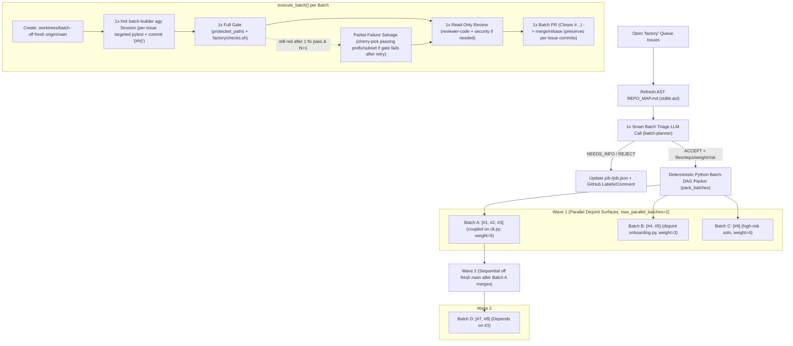

# Smart Batch Mode & Batch-DAG Execution Design

**Date:** 2026-11-15  
**Status:** Draft (Pending User Review)  
**Repository:** `software-factory-agy`

---

## 1. Overview & Goals

Replace serial, cold-subprocess single-issue execution as the default `factory run` mode with **Smart Batch Mode**: a two-level **Batch-DAG** pipeline that triages the open issue queue in one pass, packs `1..5` compatible issues per batch by complexity weight and file-surface affinity, runs disjoint batches in parallel and dependent/large clusters as sequential waves, and executes each batch inside a single hot `agy` builder session with per-issue atomic commits and targeted incremental tests.

### Problem Statement
Benchmarking single-issue execution (`job-12` → PR #13) showed that even with `gemini-3.8-flash` and 1-slice specs, one small issue took **~8m05s and 410k tokens ($0.42)** because:
1. Separate `intake`, `spec-writer`, `builder`, and `reviewer` subprocesses cold-read the repository from scratch on every stage.
2. Full `factory/checks.sh` (`~55s`) runs once per issue (and again at merge rebase when sibling PRs touch overlapping files).
3. Issues touching overlapping files (e.g., `factory/lib/pipeline.py` or `factory/cli.py`) either serialize one-by-one or collide during PR rebase.

### Core Goals
1. **Default Unified Pipeline (`N = 1..5`):** Make Smart Batch Mode the default for `factory run`. A 1-issue queue (`N = 1`) naturally executes as a 1-issue batch (skipping redundant `intake` + `spec` cold starts), while larger queues pack into `M` optimal batches.
2. **Hybrid Smart Planner (LLM Semantics + Deterministic Graph Packing):** One fast `planner` LLM call (`gemini-3.8-flash-low`) triages all queued issues (`ACCEPT` / `NEEDS_INFO` / `REJECT`), estimates `risk`, `complexity_weight` (`1..5`), `predicted_files`, and logical `depends_on` edges. Deterministic Python logic (`pack_batches()`) constructs an acyclic **Batch-DAG** that:
   - Packs file-overlapping and dependent issues of matching merge policy **into the same batch** (up to `max_batch_issues = 5` and `max_batch_weight = 6`).
   - Splits oversized coupled clusters along topological edges into **sequential waves** (`Wave 1` merges to `main` first; `Wave 2` branches off fresh `main`).
   - Schedules batches with **strictly disjoint file surfaces** in **parallel** (up to `max_parallel_batches = 2`).
   - Isolates human-gated issues (e.g., `medium`/`high` risk when `auto_merge == "low"`) into solo (`N = 1`) batches so they never hold auto-mergeable fixes hostage.
3. **Single Hot Builder Session with Per-Issue Commits:** Each batch executes in one worktree and one `batch-builder` `agy` session that implements issues in topological order, runs **targeted `pytest <test_file>`** (`1–3s`) per issue, and creates **one atomic commit per issue (`... (#<n>)`)**.
4. **Partial-Failure Isolation & Commit Salvage:** One bad or ambiguous issue never poisons an entire batch. The builder can skip an unexpected blocker (`BLOCKED` + `SKIPPED_DEP` for in-batch dependents), and if the full `factory/checks.sh` gate still fails after a fix pass, Python cherry-picks passing commits in topological order onto a clean branch, escalating only the broken issue(s) to `needs-human` while shipping the healthy subset.
5. **Individually Revertible Batch PRs:** Each completed batch opens **one GitHub PR** (`Closes #i₁`, `Closes #i₂`, …) merged via `merge` or `rebase` (never squashing multi-issue batches) so every issue retains an atomic, `git revert`-friendly commit on `main`.
6. **AST-Enriched Codebase Context:** Upgrade `generate_repo_map()` using Python's stdlib `ast` module so every batch receives a compact symbol + line-number + test-file map (`<= 150` lines) alongside `PITFALLS.md`.

### Explicit Non-Goals
- **Zero External Runtime Dependencies:** All AST indexing, graph packing, and cherry-pick salvage use Python 3.12 standard library + `git`/`gh` CLI only.
- **No Removal of Single-Issue Escape Hatch:** Legacy 5-stage single-issue execution (`process_job`) remains available via `factory run --no-batch` (or `batch.enabled: false` in `factory/config.json`) and continues handling mid-flight resumed jobs already past `queued`.
- **No Unattended Multi-Machine Fleet Activation by Default:** `GitStateStore` per-job leases remain respected when an `origin` remote exists, while local `factory run` operates self-contained without background worker daemons.

---

## 2. End-to-End Architecture



### Module Boundaries
- `factory/lib/batch.py` *(new, focused orchestration module)*:
  - Data types: `TriageItem`, `BatchSpec`, `BatchPlan`, `IssueBuildResult`, `BatchExecutionOutcome`.
  - Pure graph packer: `pack_batches(items, hard_deps, config) -> BatchPlan`.
  - Batch execution engine: `triage_and_plan_queue(...)`, `execute_batch(...)`, `salvage_passing_commits(...)`, `run_batch_factory(...)`.
- `factory/lib/onboarding.py`:
  - Upgrade `generate_repo_map(repo_root)` with stdlib `ast` symbol indexing (`class` / `def` + line numbers) and source-to-test file pairing (`factory/lib/foo.py -> tests/test_foo.py`).
- `factory/lib/schemas.py`:
  - Add `"batch_plan"` and `"batch_build"` schemas and `validate_stage_output()` rules while preserving existing `"plan"`, `"intake"`, `"spec"`, `"build"`, `"review"`, `"approve"`, and `"qa"` schemas unchanged.
- `factory/agents/batch-planner.md` & `factory/agents/batch-builder.md` *(new prompts)*.
- `factory/lib/config.py`:
  - Add `DEFAULT_CONFIG["batch"]` and `DEFAULT_CONFIG["models"]["batch_builder"]`.
- `factory/lib/state.py`:
  - Allow `"build"` in `TRANSITIONS["intake"]` so batch-triaged issues transition cleanly (`queued -> intake -> build -> gate -> review -> approve -> merging -> merged/ready`).
- `factory/lib/pipeline.py` & `factory/cli.py`:
  - Wire `run_factory(..., batch_mode: bool | None = None, max_batch_issues: int | None = None)` to delegate newly queued runs to `run_batch_factory()` when batch mode is enabled, while routing mid-flight jobs (`stage not in {"queued"}`) through existing `process_job()`.
  - Add `--no-batch` and `--max-batch <N>` to `factory run`, plus `factory plan [issues...]` dry-run subcommand.

---

## 3. Configuration & CLI Specification

### 3.1 `factory/lib/config.py` Additions
```json
{
  "batch": {
    "enabled": true,
    "max_batch_issues": 5,
    "max_batch_weight": 6,
    "max_parallel_batches": 2,
    "refresh_repo_map": true
  },
  "models": {
    "planner": "gemini-3.8-flash-low",
    "batch_builder": "gemini-3.8-flash-medium"
  }
}
```
Validation rules in `validate_config()`:
- `batch.enabled`: `bool` (default `True`).
- `batch.max_batch_issues`: `int` in `1..10` (default `5`).
- `batch.max_batch_weight`: `int` in `1..20` (default `6`).
- `batch.max_parallel_batches`: `int` in `1..8` (default `2`).
- `batch.refresh_repo_map`: `bool` (default `True`).
- `models.batch_builder`: falls back to `models.builder` if omitted in user `factory/config.json`.

### 3.2 CLI Contract (`factory/cli.py`)
1. `factory run [issues...] [--no-batch] [--max-batch N]`
   - Default: runs Smart Batch Mode (`batch.enabled == True`).
   - `--no-batch`: forces legacy single-issue `run_factory(..., batch_mode=False)` for this invocation.
   - `--max-batch N`: overrides `batch.max_batch_issues` for this invocation (`--max-batch 1` runs 1 issue per batch while still using the streamlined `batch_plan -> batch_build` pipeline).
2. `factory plan [issues...]`
   - Fetches open queue issues (or explicit `issues`), runs `triage_and_plan_queue(..., dry_run=True)` without mutating GitHub labels/comments or creating worktrees, and prints the triaged verdicts (`ACCEPT` / `NEEDS_INFO` / `REJECT`) plus the planned waves, batch groupings, complexity weights, predicted files, and batch dependency edges.
3. `_exec-job <issue>` (internal worker subprocess) continues invoking `process_job()` directly so existing `worker.py` behavior remains backwards-compatible while fleet mode stays disabled.

---

## 4. Detailed Component Design

### 4.1 AST-Enriched `REPO_MAP.md` (`factory/lib/onboarding.py`)
`generate_repo_map(repo_root)` stays deterministic, zero-dependency, and bounded to **`<= 150` lines**:
- Retains header metadata (`Detected Stack`, `Manifests`, `Tracked Files`, `Top-Level Directories`).
- Adds `## Test Mapping`: pairs tracked implementation modules (e.g. `factory/lib/<name>.py` or `src/**/<name>.py`) with matching `tests/test_<name>.py` files when present.
- Adds `## Python Symbol Index` (when Python files exist): parses tracked non-test `.py` files with `ast.parse()`, listing each module path with up to 8 key top-level `class` / `def` / `async def` symbols and their 1-based line numbers (e.g., ``- `factory/lib/state.py` → `TRANSITIONS` (L10), `load_job` (L72), `advance_stage` (L89), `record_metrics` (L245)``), prioritized by core package directories (`factory/`, `src/`, `app/`).
- When `cfg["batch"]["refresh_repo_map"]` is `True`, `run_batch_factory()` refreshes `factory/REPO_MAP.md` in-place (if untracked or clean) or passes the generated map string directly into prompts before each wave.

### 4.2 Single-Call Smart Queue Triage (`batch_plan`)
#### Schema (`SCHEMAS["batch_plan"]` in `factory/lib/schemas.py`)
```python
"batch_plan": {
    "type": "object",
    "additionalProperties": False,
    "required": ["items", "reasoning"],
    "properties": {
        "items": {
            "type": "array",
            "items": {
                "type": "object",
                "additionalProperties": False,
                "required": [
                    "issue",
                    "decision",
                    "risk",
                    "surfaces",
                    "complexity_weight",
                    "predicted_files",
                    "depends_on",
                    "topic_group",
                    "summary",
                    "questions",
                    "decision_reason",
                ],
                "properties": {
                    "issue": {"type": "integer"},
                    "decision": {"type": "string", "enum": ["ACCEPT", "NEEDS_INFO", "REJECT"]},
                    "risk": {"type": "string", "enum": ["low", "medium", "high"]},
                    "surfaces": {
                        "type": "array",
                        "items": {"type": "string", "enum": ["ui", "security"]},
                    },
                    "complexity_weight": {"type": "integer", "minimum": 1, "maximum": 5},
                    "predicted_files": {"type": "array", "items": {"type": "string"}},
                    "depends_on": {"type": "array", "items": {"type": "integer"}},
                    "topic_group": {"type": "string"},
                    "summary": {"type": "string"},
                    "questions": {"type": "array", "items": {"type": "string"}},
                    "decision_reason": {"type": "string"},
                },
            },
        },
        "reasoning": {"type": "string"},
    },
}
```
Validation invariants in `validate_stage_output("batch_plan", payload)`:
- Every item must have `decision in {"ACCEPT", "NEEDS_INFO", "REJECT"}`, `risk in {"low", "medium", "high"}`, `surfaces <= {"ui", "security"}`, and `1 <= int(complexity_weight) <= 5`.
- `NEEDS_INFO` requires non-empty `questions`; `REJECT` requires non-empty `decision_reason`.
- Missing queued issues (if the LLM ever omits one) default conservatively to `ACCEPT`, `risk="medium"`, `complexity_weight=3`, `predicted_files=[]`, preserving explicit regex `Depends on #N` edges from `parse_explicit_dependencies()`.

#### Complexity Weight Rubric (in `factory/agents/batch-planner.md`)
- `1`: Trivial config, constant, docstring, CLI help text, or `<20`-line localized fix.
- `2`: Small bugfix or check touching 1–2 files + unit test (`~20–80` lines).
- `3`: Medium feature or refactor touching 2–3 files + tests (`~80–200` lines).
- `4`: Multi-module feature requiring careful coordination (`~200–350` lines).
- `5`: Large architectural change or high-blast-radius refactor (runs solo when `max_batch_weight == 6` unless paired with a `weight=1` follow-up).

#### Immediate Non-`ACCEPT` Handling
For each queued issue `#n`:
1. Enqueue/load `factory/jobs/job-<n>/job.json` (`queued -> intake`). Write `factory/jobs/job-<n>/INTAKE.md` from the triage item.
2. If `NEEDS_INFO`: transition `intake -> needs-info`, add `cfg["labels"]["needs_info"]` label + comment with `questions` on GitHub, sync board, release lease.
3. If `REJECT`: transition `intake -> rejected`, comment `decision_reason` and close or unqueue per existing intake rules, release lease.
4. Only `ACCEPT`ed issues enter `pack_batches()`.

### 4.3 Deterministic Python Batch-DAG Packer (`pack_batches()`)
Given `accepted_items: list[TriageItem]`, explicit + LLM `hard_deps: dict[int, set[int]]` (sanitized via `_ensure_acyclic`), and `cfg`:

1. **Merge-Policy Classification (`solo_only`):**
   - `auto_merge = cfg.get("auto_merge", "low")`
   - An issue is `auto_merge_eligible` iff `auto_merge == "all"` or (`auto_merge == "low"` and `item.risk == "low"`).
   - Any issue with `not auto_merge_eligible` (or `max_batch_issues == 1`) has `solo_only = True` so human-reviewed PRs are never bundled with auto-merging PRs.

2. **Affinity & Overlap Clustering:**
   - Normalize `predicted_files` via `_normalize_conflict_surfaces()` (ignoring broad container dirs like `tests/` or `src/`).
   - Build undirected affinity edges between accepted issues `(a, b)` when:
     - `b in hard_deps[a]` or `a in hard_deps[b]`, OR
     - `_surfaces_overlap(a.predicted_files, b.predicted_files)` is `True`, OR
     - `a.topic_group and a.topic_group == b.topic_group` and neither is `solo_only`.
   - Partition accepted issues into connected components over these affinity edges.

3. **Topological Bin-Packing Within Each Component:**
   - Compute a deterministic topological order of the entire `hard_deps` graph (tie-breaking by component, `topic_group`, overlapping surfaces, then ascending issue number).
   - Maintain a list of open/finalized `BatchSpec` objects (`batch-1`, `batch-2`, …). For each issue `u` in topological order:
     - If `u.solo_only`: emit a dedicated single-issue `BatchSpec([u])`.
     - Otherwise, inspect candidate open batches in the same component where:
       1. `not batch.solo_only`
       2. `len(batch.issues) < max_batch_issues`
       3. `batch.total_weight + u.complexity_weight <= max_batch_weight`
       4. **Topological safety:** placing `u` into `batch` does not create a cycle in `batch_deps` (specifically, no `dep` of `u` — direct or transitive in `hard_deps` — belongs to a *different* batch `B_other` that already depends on `batch`).
     - Prefer a candidate batch that already contains a `hard_deps` parent of `u` or shares `_surfaces_overlap` with `u`; otherwise open a new `BatchSpec([u])`.

4. **Batch-Level Dependency Edges (`batch_deps: dict[str, set[str]]`):**
   - **Hard batch edges (`hard_batch_deps`):** If issue `v in B2` has `u in hard_deps[v]` with `u in B1` (`B1 != B2`), add `B1` to `hard_batch_deps[B2]` and `batch_deps[B2]`.
   - **Wave-ordering overlap edges (`soft_batch_deps`):** For every pair of distinct batches `(B1, B2)` ordered by creation index, if `_surfaces_overlap(B1.predicted_files, B2.predicted_files)` and no path already connects `B1` and `B2`, add `B1` to `batch_deps[B2]`.
   - **Resulting Guarantees:**
     - `batch_deps` is strictly acyclic (verified with `graphlib.TopologicalSorter(batch_deps).prepare()`).
     - Any two batches ready concurrently in `TopologicalSorter.get_ready()` have **zero `hard_deps` between them and strictly disjoint `predicted_files`**.
     - Coupled clusters larger than `max_batch_weight` automatically become sequential waves (`B1 -> B2`), so `B2` branches off `origin/main` *after* `B1` merges!

### 4.4 Hot Batch Builder Session (`batch-builder`)
#### Worktree & Lease Setup
When `BatchSpec` `B` becomes ready in `TopologicalSorter`:
1. Claim `GitStateStore` leases (`claim_job_lease("job-<n>")`) for each `#n` in `B.issues` (if `state_store` is active). Any issue already leased by another host is dropped from `B` (along with in-batch `hard_deps` children).
2. Fetch `origin/<base_branch>` and create `.worktrees/<batch_id>` on branch `factory/<batch_id>` from `origin/<base_branch>`.
3. Advance each `#n` in `B.issues`: `intake -> build`, recording `batch_id = B.id` and `worktree = .worktrees/<batch_id>`.

#### Builder Prompt & Commit Protocol (`factory/agents/batch-builder.md`)
Single `run_agent()` call (`agent_name="batch-builder"`, `stage="batch_build"`, `model=builder_model`, `require_clean_worktree=True`):
- Model routing: if `len(B.issues) == 1` and `B.issues[0].risk == "low"` and `B.issues[0].complexity_weight == 1` and `cfg["models"].get("builder_low")`, use `builder_low`; otherwise `cfg["models"]["batch_builder"]` (`gemini-3.8-flash-medium`).
- Timeout scaling: `min(2400, int(cfg["agent_timeout_sec"]) + 240 * (len(B.issues) - 1))` so a 4-issue batch isn't starved by a single-slice timeout.
- Prompt rules enforced:
  1. Work through `[#i₁, #i₂, …, #iₖ]` in exact listed order.
  2. For `#n`, implement code + unit tests, run **only targeted tests** (e.g. `python3 -m pytest tests/test_foo.py -q`), and commit all changes for `#n` in **one commit** whose subject ends with `(#<n>)` (e.g. `feat: add ast symbol map to onboarding (#15)`).
  3. **Never** run full `factory/checks.sh` per issue; Python runs the full gate once at the end.
  4. **Never** modify `protected_paths` (respecting `allow_self_host` rules).
  5. If `#n` is blocked by missing external credentials, contradictory issue requirements, or an unfixable failure after 2 local attempts: discard uncommitted changes (`git checkout -- . && git clean -fd`), mark `#n` as `"BLOCKED"` with `blocked_reason`, mark any later issue in `B` whose `in_batch_depends_on` includes `#n` as `"SKIPPED_DEP"`, and continue building remaining independent issues.

#### Schema (`SCHEMAS["batch_build"]` in `factory/lib/schemas.py`)
```python
"batch_build": {
    "type": "object",
    "additionalProperties": False,
    "required": ["results", "notes"],
    "properties": {
        "results": {
            "type": "array",
            "minItems": 1,
            "items": {
                "type": "object",
                "additionalProperties": False,
                "required": [
                    "issue",
                    "status",
                    "commit",
                    "summary",
                    "changes",
                    "tests_run",
                    "blocked_reason",
                ],
                "properties": {
                    "issue": {"type": "integer"},
                    "status": {"type": "string", "enum": ["DONE", "BLOCKED", "SKIPPED_DEP"]},
                    "commit": {"type": "string"},
                    "summary": {"type": "array", "items": {"type": "string"}},
                    "changes": {"type": "array", "items": {"type": "string"}},
                    "tests_run": {"type": "array", "items": {"type": "string"}},
                    "blocked_reason": {"type": "string"},
                },
            },
        },
        "notes": {"type": "string"},
    },
}
```
Validation invariants in `validate_stage_output("batch_build", payload)`:
- Every result entry must have `status in {"DONE", "BLOCKED", "SKIPPED_DEP"}` and integer `issue`.
- `status == "BLOCKED"` requires non-empty `blocked_reason`.
- Duplicate `issue` entries in `results` are rejected.

### 4.5 Deterministic Verification, Gate, Review & Commit Salvage
After `batch-builder` finishes:

1. **Commit & Protected-Path Audit:**
   - Inspect `git log --reverse --format="%H %s" origin/<base_branch>..HEAD` in `.worktrees/<batch_id>`.
   - Match each `"DONE"` issue `#n` to its commit(s) by reported SHA prefix and/or `(#<n>)` subject tag. If an issue claims `"DONE"` without a valid commit on `origin/<base_branch>..HEAD`, reclassify it as `"BLOCKED"` (`"Builder reported DONE without creating a commit"`).
   - If `"BLOCKED"` / `"SKIPPED_DEP"` issues exist, escalate those individual `job-<n>` records to `needs-human` (with `blocked_reason` commented on GitHub and `factory:needs-human` label applied) and record `#n` in `unmerged_issues` so downstream batches with `hard_deps` on `#n` skip dependents cleanly.
   - If zero `"DONE"` issues remain, clean up `.worktrees/<batch_id>` and finish the batch.
   - Check `find_protected_violations()` across `origin/<base_branch>..HEAD`.

2. **Full Gate + Single Read-Only Review Loop (up to `max_rounds`):**
   - Advance surviving `DONE` jobs `build -> gate` and run `factory/checks.sh` **once** on `.worktrees/<batch_id>`.
   - If gate passes: advance surviving jobs `gate -> review` and run **one** read-only `reviewer-code` call (plus `reviewer-security` in parallel if any surviving issue has `"security"` in `surfaces` or diff touches auth/crypto/subprocess paths).
   - If `PASS` (zero `must_fix` / `should_fix`, or `auto_polish` satisfied): advance `review -> approve` (using `auto_approve_clean` fast-path when all reviews are clean and no protected violations exist; otherwise 1 `approver` call).
   - If gate fails, protected paths were touched, or review returns `CHANGES`, and `round < max_rounds`:
     - Advance jobs back to `build`, invoke `batch-builder` in `.worktrees/<batch_id>` with the exact gate tail / review findings (`fix_prompt`), instructing it to commit a targeted fix (`fix: address gate/review feedback (#<n>)`) without squashing prior per-issue commits, then re-run gate + review.

3. **Partial-Failure Commit Salvage (`salvage_passing_commits()`):**
   - Triggered when `len(done_issues) > 1` and the batch **still** fails `protected_paths` or `factory/checks.sh` after exhausting its retry pass.
   - Creates clean salvage ref at `origin/<base_branch>`:
     - Iterates `done_issues` in topological order:
       - If any `dep in hard_deps[n]` failed salvage, marks `#n` failed (`"Prerequisite #<dep> failed batch salvage"`).
       - Otherwise cherry-picks commit(s) attributed to `#n` (`git cherry-pick --no-edit <sha>`).
       - Checks `find_protected_violations()` and runs `factory/checks.sh` on the candidate prefix.
       - If cherry-pick conflicts or gate fails: `git cherry-pick --abort` / `git reset --hard <last_good_sha>`, marks `#n` failed (`needs-human`), and continues testing remaining independent issues!
   - If `>= 1` issue survives salvage: resets `factory/<batch_id>` to `<last_good_sha>`, runs 1 read-only `review` pass on the salvaged diff, and proceeds to PR/merge for the surviving issues while escalating failed issue(s) to `needs-human`.
   - If `0` issues survive salvage: escalates all remaining issues in the batch to `needs-human`.

### 4.6 PR Creation, Non-Squash Merge & Per-Issue `job.json` Tracking
1. **Batch PR Creation:**
   - Push `factory/<batch_id>` to `origin`.
   - Title:
     - `len(surviving) == 1`: `<issue title> (#<n>)`
     - `len(surviving) > 1`: `batch: #<i₁>, #<i₂>, ... (<k> issues)`
   - Body includes `Closes #<n>` on separate lines for every surviving issue (so GitHub auto-closes all merged issues atomically), followed by a per-issue summary + commit SHA table and gate/review verification summary.
2. **Merge Policy & Commit Preservation:**
   - If all surviving issues are auto-mergeable (`auto_merge == "all"` or `auto_merge == "low"` and all have `risk == "low"`):
     - Advance jobs `approve -> merging`.
     - Acquire local/distributed `merge_lock`: if `origin/<base_branch>` advanced since branch creation (e.g., a parallel disjoint batch merged first), rebase `factory/<batch_id>` (`git rebase origin/<base_branch>`) preserving individual commits and re-run `factory/checks.sh` once before merging.
     - **Merge method rule:** For `len(surviving) > 1`, if `cfg["merge_method"] == "squash"`, use `"merge"` instead so per-issue commits (`(#<n>)`) remain individually revertible on `main`. For `len(surviving) == 1`, honor `cfg["merge_method"]` directly.
     - On merge: advance all surviving jobs `merging -> merged` (or `staging_qa` if `staging_qa.enabled`), sync board, and prune `.worktrees/<batch_id>`.
   - Otherwise (solo human-gated batch):
     - Advance job `approve -> ready`, comment PR link, sync board, and leave branch open for `reconcile_ready_jobs()`.
3. **Per-Issue `job.json` & Metrics Attribution:**
   - Every issue `#n` retains its own `factory/jobs/job-<n>/job.json` with `batch_id`, `commit_sha`, `pr_url`, and `pr_number`.
   - Shared batch stage costs/tokens (`batch_plan`, `batch_build`, `gate`, `review`) are recorded via `record_metrics()` on each participating `job-<n>/job.json` weighted proportionally by `complexity_weight / sum(batch_weights)` (so summing `estimated_cost_usd` across all jobs in `factory stats` equals exact total spend without N× double-counting!).
   - Cost budget check: total batch spend is checked against `max_job_cost_usd * len(surviving)` when `max_job_cost_usd > 0`.

---

## 5. Error Handling & Edge Cases

| Scenario | Behavior |
|---|---|
| **Global Halt (`factory halt`)** | Checked before `triage_and_plan_queue`, before each batch starts, and inside `run_agent` / gate subprocesses. Halted batches leave `job-<n>` in current stage (never `needs-human`), releasing leases cleanly. |
| **LLM Quota `429` (`QuotaExhaustedError`)** | Propagates shared backoff to `refs/factory/quota` (if `state_store` active) and stops scheduling new batches cleanly without marking issues `needs-human`. |
| **Downstream Batch Depends on Failed Issue `#X`** | If Batch A merges `#1, #2` while `#3` fails (`BLOCKED` or dropped in salvage), Batch D (`[#7, #8]` where `#7` depends on `#3` and `#8` depends on `#1`) drops `#7` (`needs-human`: prerequisite `#3` did not merge) and still executes `#8`! |
| **Mid-Flight Resumed Jobs (`stage != "queued"`)** | Before batch planning, `run_factory()` runs `reconcile_ready_jobs()` and routes any explicit or existing mid-flight jobs (`stage in {"spec", "build", "gate", "review", "approve", "merging", "staging_qa"}`) through `process_job()` so interrupted legacy runs finish seamlessly. |
| **Rebase Conflict Between Parallel Batches** | Disjoint surface packing prevents predicted conflicts; if an unpredicted shared file conflicts during pre-merge `git rebase origin/main`, `execute_batch` runs 1 conflict-fix/cherry-pick pass or leaves PR in `needs-human` without corrupting `main`. |

---

## 6. Testing Plan

1. **AST `REPO_MAP.md` (`tests/test_onboarding.py`):**
   - Extracts Python classes/functions with accurate 1-based line numbers, maps `factory/lib/foo.py` ↔ `tests/test_foo.py`, handles syntax-invalid `.py` files gracefully without crashing, and stays `<= 150` lines on large repos.
2. **Schemas (`tests/test_schemas.py`):**
   - Validates `batch_plan` (enum bounds, `NEEDS_INFO` questions requirement, `REJECT` reason requirement, weight `1..5`) and `batch_build` (`DONE`/`BLOCKED`/`SKIPPED_DEP` rules).
3. **Deterministic Batch-DAG Packer (`tests/test_batch.py`):**
   - Overlapping `predicted_files` pack into the same batch (`len <= 5`, `weight <= 6`).
   - Coupled cluster exceeding `max_batch_weight` splits into `Wave 1 -> Wave 2` (`batch_deps[B2] == {B1}`).
   - Strictly disjoint clusters produce parallel root batches (`batch_deps[B1] == set()`, `batch_deps[B2] == set()`).
   - `medium`/`high` risk issues under `auto_merge="low"` pack as `solo_only` (`N = 1`) batches, never mixed with `low`-risk batches.
   - Explicit `Depends on #N` in issue body is enforced even if omitted by LLM; cyclic LLM edges are broken deterministically.
4. **Batch Execution & Salvage (`tests/test_batch.py`):**
   - **Happy path (`N = 3`):** 1 `batch-builder` call producing 3 `(#n)` commits → 1 `checks.sh` run → 1 read-only `reviewer-code` → 1 PR (`Closes #1\nCloses #2\nCloses #3`) merged via `"merge"` even if config requested `"squash"`, updating all 3 `job-<n>/job.json` records with proportional cost metrics and pruning `.worktrees/batch-*`.
   - **Mid-batch `BLOCKED` + `SKIPPED_DEP`:** `#2` blocked (`#3` depends on `#2`, `#1` independent) → `#1` merges via PR, `#2` and `#3` transition to `needs-human`.
   - **Partial-failure cherry-pick salvage:** `#1, #2, #3` all committed, `#2` breaks `checks.sh` even after 1 fix round → `salvage_passing_commits` cherry-picks `#1` and `#3` onto clean `origin/main`, drops `#2` (`needs-human`), and merges `#1` + `#3`!
   - **Parallel + Sequential Wave Execution:** Batch A (`#1, #2`) and disjoint Batch B (`#3, #4`) run concurrently in Wave 1; Batch C (`#5` depending on `#2`) waits for Batch A to merge, then runs in Wave 2.
   - **CLI & Escape Hatches:** `factory plan` prints wave breakdown without side effects; `factory run --no-batch` routes through legacy `process_job`.
