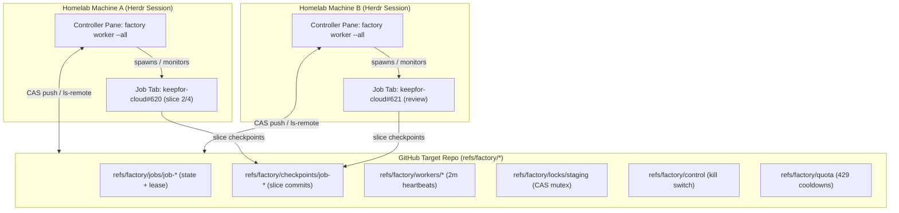

# Multi-Machine Durable Software Factory Design

**Date:** 2026-11-15  
**Status:** Draft (Pending User Review)  
**Repository:** `software-factory-agy`

---

## 1. Overview & Goals

Transform `software-factory-agy` from a single-machine, one-shot CLI (`factory run`) into a **durable, multi-machine autonomous software factory** tailored for personal desktops, laptops, and homelab machines connected via Tailscale SSH and GitHub.

### Core Goals
1. **Zero Central Infrastructure:** No central coordinator server, daemon, message broker, or cloud database to host or maintain. All cross-machine coordination uses **native Git refs (`refs/factory/*`) with atomic `--force-with-lease` Compare-And-Swap** on GitHub.
2. **Homelab-First Visibility & Intervention via Herdr:** Each machine runs `factory worker --all` inside **Herdr** (`herdr.dev`), reporting live semantic state (`working`, `idle`, `blocked`), custom progress labels, and native session-restore commands (`pane report-agent` / `pane report-metadata`). From a single Herdr window on any machine, an operator sees every machine's active jobs, receives desktop notifications on `needs-human`, and attaches directly into any remote job's worktree.
3. **Mid-Job Crash Recovery:** Checkpoints job metadata and completed TDD slices to Git (`refs/factory/jobs/*` and `refs/factory/checkpoints/*`) so if a machine powers off or drops offline after Slice 2/4, another machine reclaims the expired lease and resumes directly at Slice 3/4.
4. **Global Kill Switch (`factory halt` / `factory resume`):** An emergency brake that grinds the entire fleet to a halt within seconds, cleanly terminates in-flight `agy` / gate subprocesses without burning retry rounds or escalating to `needs-human`, saves slice checkpoints, and resumes seamlessly later.
5. **Polite Shared-Machine Resource & Quota Governance:** Dynamically yields when a human is actively taxing CPU/RAM on a machine, spreads small issue batches evenly across idle machines instead of hogging one host, and turns LLM `429` / quota errors into shared fleet-wide cooldowns rather than job failures.

### Explicit Non-Goals & Assumptions
- **Symmetric Per-Repo Environments:** Every machine listing a repo in `~/.config/factory/repos.json` is provisioned to pass `factory doctor` for that repo (including staging secrets/tools if `staging_qa.enabled` is `true`). No cross-machine mid-pipeline capability routing is required.
- **POSIX Runtime Everywhere:** Target worker OSes are Linux, macOS, and Windows via **WSL2** (preserving Bash `factory/checks.sh`, `fcntl.flock`, and POSIX process groups).
- **No Custom Web Dashboard:** Fleet UI, live log viewing, notifications, and interactive terminal attachment are delegated entirely to Herdr + `factory status --all`.

---

## 2. Three-Phase Rollout Architecture

The design is cohesive end-to-end and implemented in three ordered, independently testable phases:

1. **Phase 1 — Git-Native Distributed Leases, Checkpoints, Locks & Kill Switch (`factory/lib/git_state.py`)**  
   Replaces local-only coordination with atomic `refs/factory/*` leases, per-machine heartbeats, slice-level crash checkpoints, cross-machine staging locks, `factory halt` / `factory resume`, and fleet-wide `factory status`.
2. **Phase 2 — Herdr-Native Worker, Spread-First Scheduler & Fleet CLI (`factory/lib/herdr_bridge.py`, `factory/lib/worker.py`, `factory/lib/fleet.py`)**  
   Continuous competing-consumer `factory worker --all` loop with spread-first pacing, warm-worktree affinity, ephemeral per-job Herdr tabs, interactive `needs-human` rescue panes, local `factory pause` / `unpause`, and `factory fleet` SSH helpers.
3. **Phase 3 — Homelab-Polite Resource & Shared LLM Quota Governor (`factory/lib/governor.py`, `factory/lib/agy_runner.py`)**  
   Host CPU/RAM admission checks before job claims and between slices, plus `QuotaExhaustedError` detection and shared exponential backoff via `refs/factory/quota`.



---

## 3. Detailed Component Design

### 3.1 Git-Native State, Leases & Checkpoints (`factory/lib/git_state.py`)

All cross-machine coordination inside each target repo lives under `refs/factory/*`, manipulated via fast Git object plumbing (`git hash-object -w`, `git mktree`, `git commit-tree` with **zero parent commits**, `git cat-file`, `git ls-remote`, `git fetch`, and `git push --force-with-lease`).

- **Zero Working-Tree Interference:** Plumbing writes directly to `<repo>/.git/objects` in <10ms without touching `HEAD`, `.git/index`, or any `.worktrees/*` checkout.
- **Zero GitHub Actions / Notification Spam:** Custom `refs/factory/*` live outside `refs/heads/*` and `refs/tags/*`, so pushes never trigger `on: push` / `on: pull_request` CI workflows, never consume private-repo GitHub Actions minutes, and generate zero emails or PR timeline clutter.
- **Zero History Bloat:** Orphan commits keep ref trees at ~5–15 KB; overwritten orphan objects are garbage-collected automatically by GitHub.

#### Ref Namespace Layout (per target repository)

| Ref Path | Tree Contents | Update Cadence & Purpose |
| :--- | :--- | :--- |
| `refs/factory/workers/<machine_id>` | `worker.json` | Written every **120s** (TTL = **360s**) by `<machine_id>`. Proves liveness for all jobs/locks held by that machine and advertises free capacity. |
| `refs/factory/jobs/job-<N>` | `job.json`, `intake.json`, `intake.md`, `spec.json`, `spec.md`, `plan.json`, `qa-failure.md`, `round-*/slice-*-build.json`, `round-*/review-*.json` | CAS-updated only on **claim**, **slice completion**, **stage transition**, **lease release**, or **halt** (~8 pushes per job lifecycle). Excludes raw `logs/`. |
| `refs/factory/checkpoints/job-<N>` | Git commit SHA of `.worktrees/job-<N>` `HEAD` | Updated after each completed TDD slice during `build`. Avoids pushing `refs/heads/factory/job-<N>` mid-round when an open Draft PR would trigger CI runs. Deleted once `merged`. |
| `refs/factory/locks/staging` | `lock.json` | CAS mutex (`TTL = 1800s`, tied to holder's worker heartbeat) serializing `merging` + `staging_qa` across all machines for that repo. |
| `refs/factory/dag` | `dag.json` | Cached Planner dependency output keyed by `issue_set_hash` (`sha256` of sorted queued issue numbers + updated timestamps) so peers reuse one Planner LLM call. |
| `refs/factory/control` | `control.json` | Fleet-wide kill switch (`{"halted": bool, "reason": str, "halted_by": str, "halted_at": str}`). |
| `refs/factory/quota` | `quota.json` | Shared LLM rate-limit backoff table (`{"models": {"<base_model>": {"cooldown_until": str, "consecutive_429s": int, "reported_by": str, "reason": str}}}`). Written to `refs/factory/quota` on the active repo and broadcast to all registered repos in `repos.json` (containing only model IDs and timestamps, never repo-private data) so a 429 in one repo pauses matching model calls across all repos and machines. |

#### Lease Model & Split-Brain Fencing
1. **Lease Structure inside `job.json`:**
   ```json
   "lease": {
     "worker_id": "ryzen-box",
     "hostname": "ryzen-box",
     "pid": 48210,
     "fencing_token": 4,
     "acquired_at": "2026-11-15T20:00:00Z"
   },
   "last_worker_id": "ryzen-box"
   ```
2. **Determining Lease Validity:** A job lease is **active** if `lease` is non-null AND the holder's `refs/factory/workers/<worker_id>` ref exists with `expires_at > now_utc` (with a 60s clock-skew safety margin: takeover requires `now_utc > expires_at + 60s`, i.e., 7 minutes of silence after crash, whereas explicit lease release sets `lease = null` for **0-second** takeover).
3. **Atomic Claim (`claim_job_lease`):**
   - Fetch `refs/factory/jobs/job-<N>` (recording `<old_sha>`, or `0000...0000` if absent) and `refs/factory/workers/*`.
   - Abort if `job.stage` is in `{"merged", "ready", "rejected", "needs-info", "needs-human"}` or if `lease` is currently active under another worker.
   - Increment `fencing_token = prev_fencing_token + 1`, set `lease.worker_id = my_machine_id`, `last_worker_id = my_machine_id`, build orphan commit `<new_sha>`, and execute:
     ```bash
     git push --force-with-lease=refs/factory/jobs/job-<N>:<old_sha> origin <new_sha>:refs/factory/jobs/job-<N>
     ```
   - Non-zero exit means a peer won the race; return `False` immediately.
4. **Fencing Against Zombie Workers:**
   - The local worker heartbeat thread tracks the last successful push of `refs/factory/workers/<machine_id>`. If local heartbeat pushes fail continuously until within 30s of `expires_at` (5m30s of network outage), the worker raises `LeaseLostError`, kills active `agy` child process groups, and refuses to push `refs/heads/factory/job-<N>` or merge PRs.
   - Every checkpoint write to `refs/factory/jobs/job-<N>` uses `--force-with-lease=...:<last_pushed_sha>`, so if a zombie worker ever reconnects after another machine incremented `fencing_token`, GitHub rejects the stale write.

#### Mid-Job Crash Takeover Hydration
- **Checkpoint Write Order:** After each slice commit in `build`, the worker (1) pushes `HEAD` to `refs/factory/checkpoints/job-<N>`, then (2) CAS-pushes `refs/factory/jobs/job-<N>` with incremented `completed_slices` and slice build artifacts.
- **Takeover Read Order:** When Machine B claims a previously started job (`fencing_token > 1`):
  1. Materializes the `refs/factory/jobs/job-<N>` tree into local `factory/jobs/job-<N>/`.
  2. Fetches `refs/factory/checkpoints/job-<N>` (if present) or `origin/<job.branch>` (if a PR branch already exists), resetting `.worktrees/job-<N>` to the checkpoint SHA (falling back to `origin/<base_branch>` if `completed_slices == 0`).
  3. Resumes execution at the exact saved `stage`, `round`, and `completed_slices`.
- **Automatic Ref Pruning:** Once a job reaches `merged`, the worker deletes `refs/factory/checkpoints/job-<N>`. Once per 24h, the worker deletes terminal `refs/factory/jobs/*` refs whose `updated` timestamp is > 30 days old.

#### GitHub Free Budget Verification
- **GitHub Actions Minutes:** `0` extra minutes consumed (`refs/factory/*` and `refs/factory/checkpoints/*` do not trigger workflows).
- **Git Push Rate:** `1` worker heartbeat push per 2 min (`30/hr/machine`) + `~8` job state pushes per issue — ~90% lower than per-job heartbeating.
- **REST & GraphQL API:** 90s jittered queue polling across 3 repos × 3 machines = `~360` REST req/hr (`7.2%` of 5,000/hr GitHub Free quota).

---

### 3.2 Work Distribution & Scheduling (`factory/lib/worker.py`)

Machines operate as peer **competing consumers** governed by `~/.config/factory/host.json`:

```json
{
  "machine_id": "desktop-linux",
  "max_workers": 3,
  "poll_interval_sec": 90,
  "ramp_up_delay_sec": 15,
  "min_free_ram_gb": 4.0,
  "max_cpu_load_pct": 75.0
}
```
*(All fields optional; `machine_id` defaults to sanitized `socket.gethostname()`, `max_workers` defaults to `2`. One-shot `factory run` also uses the same `refs/factory/*` lease and `refs/factory/control` checks so manual CLI runs and continuous `factory worker` instances never collide.)*

#### Four-Rule Distribution Algorithm
1. **Repo Eligibility:** Each machine only polls repos listed in its local `~/.config/factory/repos.json` that pass `run_doctor` at worker startup.
2. **Admission Checks (Pre-Claim):**
   - Fleet `refs/factory/control` has `halted == false`.
   - Local `~/.config/factory/paused` flag is absent.
   - Local `active_jobs < host.max_workers`.
   - Governor reports host CPU load `< max_cpu_load_pct` and free RAM `>= min_free_ram_gb`.
   - Shared `refs/factory/quota` has no active cooldown for `intake` / `builder` models.
   - Target repo's active leased job count across all machines (`refs/factory/jobs/*`) is `< repo_cfg["concurrency"]`.
3. **Spread-First Pacing (`ramp_up_delay_sec = 15`):**
   - A poll tick claims **at most 1 job**, launches it, and waits `ramp_up_delay_sec` (15s) before attempting to fill another local slot.
   - This guarantees a small batch (e.g., 3 issues across 3 idle machines) spreads `1-1-1` across machines so each `checks.sh` / `pytest` gate gets uncontended CPU/RAM, while still ramping a single online machine up to its full `max_workers` within `15s * max_workers` if peer machines are offline or busy.
4. **Candidate Ordering (Warm Affinity + Collision-Free Tie-Breaking):**
   - **Tier 1 — Own interrupted/halted jobs:** Non-terminal unclaimed jobs in `refs/factory/jobs/*` where `last_worker_id == my_machine_id` (warm `.worktrees/job-<N>` already on disk).
   - **Tier 2 — Peer orphaned/halted jobs:** Non-terminal unclaimed jobs where `last_worker_id != my_machine_id`. If `last_worker_id` has a live worker heartbeat with `free_slots > 0` and `paused == false`, peers wait one `15s` grace window from lease release so the warm machine reclaims it first; if `last_worker_id` is offline, paused, or full, peers claim immediately.
   - **Tier 3 — Fresh DAG-ready GitHub issues:** Filtered by `refs/factory/dag` (`order_deps` satisfied), sorted by `(dag_wave, sha256(f"{machine_id}:{issue_number}"))` so machines waking simultaneously attempt *different* ready issues first without `--force-with-lease` collisions.

---

### 3.3 Global Kill Switch & Local Polite Pause

| Command | Scope | Mechanism & Effect |
| :--- | :--- | :--- |
| `factory halt [--reason TEXT] [--force]` | **Entire Fleet** (all machines & repos) | 1. Writes `halted=true` to `refs/factory/control` on all target repos.<br>2. Writes local `~/.config/factory/halt.signal` and sends non-interactive SSH signal to reachable Herdr machines for sub-second response.<br>3. Active jobs terminate `agy` / `checks.sh` immediately (unless mid-`deploy_to_staging` without `--force`, which finishes/rolls back atomically first), run `reset_worktree_clean`, push last completed slice to `refs/factory/checkpoints/job-<N>`, CAS-update `refs/factory/jobs/job-<N>` with `lease=null, activity="halted"` (**no round/retry increment, no `needs-human` escalation**), and close ephemeral job tabs.<br>4. Controller panes park in `idle ("HALTED: <reason>")`. |
| `factory resume` | **Entire Fleet** | Writes `halted=false` to `refs/factory/control`, clears local/remote halt signals, and pokes reachable workers to poll immediately and resume saved jobs. |
| `factory pause [--drain]` | **Single Machine** | Writes `~/.config/factory/paused`. Default stops claiming new jobs while finishing in-flight jobs; `--drain` aborts current `agy` steps at the last clean slice and releases leases (`lease=null`) so other machines pick them up immediately. |
| `factory unpause` | **Single Machine** | Removes `~/.config/factory/paused` and triggers an immediate poll on this machine. |

Workers also check `refs/factory/control` via lightweight `git ls-remote` every **20 seconds** inside the background heartbeat loop so even machines unreachable over inbound SSH halt within 20s of `factory halt`.

---

### 3.4 Herdr-Native Runtime & Fleet CLI (`herdr_bridge.py`, `fleet.py`)

#### First-Class Self-Reporting Protocol (`factory/lib/herdr_bridge.py`)
- Active only when `os.environ.get("HERDR_ENV") == "1"` and `HERDR_BIN_PATH` + `HERDR_PANE_ID` are set; otherwise all methods are fast no-ops (preserving standalone CLI & `pytest` behavior).
- Uses monotonic millisecond `--seq`, `timeout=3s`, and background/best-effort execution so Herdr IPC never blocks or crashes the pipeline.
- **Controller Pane (`factory worker --all`):**
  - Reports `pane report-agent "$HERDR_PANE_ID" --source factory:worker --agent factory-worker --state working|idle -- factory worker --all` so Herdr's default `resume_agents_on_restore = true` automatically restarts the worker when a Herdr session restores.
  - Updates `pane report-metadata` with `--display-agent "Factory (<active>/<max>)"` and `--state-label` (`"2 running"`, `"idle (queue empty)"`, `"paused"`, `"throttled (CPU 84%)"`, `"HALTED"`).
- **Ephemeral Job Tabs (`factory _exec-job --repo <repo> <issue>`):**
  - When running inside Herdr, `factory worker` spawns a background tab in `$HERDR_WORKSPACE_ID` (`herdr tab create --workspace "$HERDR_WORKSPACE_ID" --title "<repo>#<issue>" --cwd "<repo>" --no-focus`) and starts `factory _exec-job` inside its root pane (outside Herdr, `factory worker` runs `_exec-job` in a local worker thread/subprocess).
  - Job pane reports `--source factory:job --agent factory-job`, `--display-agent "<repo>#<issue>"`, and updates `--state-label working="round 1 | slice 2/4 (builder)"` at every stage/slice transition.
  - **Clean Completion (`merged`, `ready`, `rejected`, `needs-info`, `halted`):** Calls `pane release-agent` and `herdr tab close` on its own tab so completed jobs never clutter the sidebar.
  - **Human Intervention (`needs-human`):** Calls `pane report-agent ... --state blocked --message "<concise error>"` (illuminating the red **Blocked** badge in Herdr's cross-machine sidebar and triggering Herdr's native desktop notification/sound), prints the worktree path + escalation details, and leaves an interactive rescue shell in `.worktrees/job-<N>`.

#### Fleet CLI (`factory fleet`) & Global `factory status`
- **`factory fleet status | wake | pause | unpause`:**
  - Discovers peer hosts from `herdr machine list --json` (supplemented by optional `~/.config/factory/fleet.json` SSH targets).
  - `factory fleet wake`: Runs `ssh -o BatchMode=yes <target>` over Tailscale to ensure `herdr` has a `factory` workspace running `factory worker --all` (solving cold-start after an unattended OS reboot).
  - `factory fleet pause [<machine>]` / `unpause [<machine>]`: Invokes `factory pause` / `factory unpause` locally or on the specified SSH target(s).
- **`factory status [--all]`:**
  - Fetches `refs/factory/control`, `refs/factory/workers/*`, `refs/factory/quota`, and `refs/factory/jobs/*` (falling back to local `factory/jobs/` for legacy history) and prints:
    1. Fleet banner (`RUNNING` vs `HALTED`, active quota cooldowns, live connected machines with `slots`, `CPU%`, `free RAM`, `state`).
    2. Per-repo job table adding a `MACHINE` column (`ryzen-box`, `-` when unleased/completed).

---

### 3.5 Homelab-Polite Resource & Shared Quota Governor (`governor.py`)

1. **Host CPU & Memory Probe (`check_host_capacity`):**
   - **Linux / WSL2:** Reads `MemAvailable` from `/proc/meminfo` and 1-minute load average from `os.getloadavg() / os.cpu_count() * 100`.
   - **macOS:** Reads free + inactive/speculative pages via `vm_stat` + `sysctl -n hw.pagesize` and `os.getloadavg() / os.cpu_count() * 100`.
   - Evaluated **before claiming a job** and **between build slices**. If a human starts a heavy workload mid-job, the active slice finishes, checkpoints cleanly, and if host load stays above `max_cpu_load_pct` (or free RAM below `min_free_ram_gb`) for > 60s, the worker releases the lease (`activity="yielded: host busy"`) so an idle homelab machine can finish the remaining slices instead of stalling.
2. **LLM `429` / Quota Classification & Shared Cooldown:**
   - `agy_runner.py` inspects non-zero `agy` outputs/logs for rate-limit signatures (`429`, `RESOURCE_EXHAUSTED`, `rate limit exceeded`, `quota exceeded`) and raises `QuotaExhaustedError(model_spec, retry_after_sec)` **immediately** without wasting the stage's single retry attempt.
   - `pipeline.py` catches `QuotaExhaustedError`, writes/extends the cooldown entry in `refs/factory/quota` (`120s` → `300s` → `900s` → `3600s` max, honoring explicit retry-after hints if larger), checkpoints the job, and releases its lease (`activity="cooldown: quota"` — **never** `needs-human`).
   - All machines read `refs/factory/quota` before claiming or launching an agent for that base model, pausing cleanly until `cooldown_until` passes, then clearing `consecutive_429s` on the first successful agent call.

---

## 4. Error Handling & Edge-Case Matrix

| Failure / Scenario | System Behavior |
| :--- | :--- |
| **Machine power loss / kernel panic mid-slice** | Uncommitted partial files stay on dead machine; `refs/factory/workers/<dead>` expires after 6m (+60s skew buffer). Peer machine CAS-claims `job-<N>`, checks out `refs/factory/checkpoints/job-<N>` (last completed slice), and resumes at `completed_slices + 1`. |
| **Wi-Fi drop > 6m while `agy` is still running (Split-Brain)** | Disconnected machine fails worker heartbeat renewals; at 5m30s (`expires_at - 30s`) local `LeaseLostError` kills child `agy` process group. Even if process hung, `--force-with-lease` rejects any stale checkpoint push because peer incremented `fencing_token`. |
| **Two machines merge to `keepfor-cloud` simultaneously** | Both enter `_execute_staging_train_batch` and contend on `refs/factory/locks/staging` via `--force-with-lease`. Winner runs merge + deploy + Playwright QA; loser waits/polls until lock releases or expires, then syncs against the new `origin/main` tip and runs its own train. |
| **`factory halt` issued while `deploy_to_staging` is mid-flight** | Default `factory halt` lets the active `deploy_to_staging` / `rollback_staging` subprocess finish atomically so staging Workers are never left half-deployed, then halts before browser QA or next stage. `factory halt --force` kills immediately. |
| **LLM 429 burst across 3 machines simultaneously** | Each affected job catches `QuotaExhaustedError`, checkpoints without incrementing `round`, releases lease, and CAS-merges cooldown into `refs/factory/quota`. Fleet idles until `cooldown_until`, then resumes smoothly. |

---

## 5. Verification & Testing Strategy

All automated tests run offline in `pytest` using temporary bare Git repositories (`tmp_path / "origin.git"`) and mocked `HERDR_BIN_PATH` / SSH / `agy` executables:

1. **`tests/test_git_state.py` (Phase 1):**
   - Concurrent multi-thread `--force-with-lease` races on `claim_job_lease` and `acquire_staging_lock` verifying exactly 1 winner and monotonic `fencing_token`.
   - Worker heartbeat expiry takeover vs. active heartbeat rejection.
   - Mid-build crash simulation after Slice 2/4 on Worker A → hydration and Slice 3/4 resume on Worker B from `refs/factory/checkpoints/job-<N>`.
   - `factory halt` / `factory resume` state transitions ensuring zero `round` increments and zero `needs-human` escalations.
   - Ref GC pruning of `checkpoints/*` on merge and >30-day terminal job refs.
2. **`tests/test_worker_and_herdr.py` (Phase 2):**
   - Spread-first scheduler distributing 3 issues `1-1-1` across 3 simulated workers instead of `3-0-0`.
   - Warm-worktree affinity preferring `last_worker_id` when online and immediate peer takeover when `last_worker_id` is paused/offline.
   - Mock `HERDR_BIN_PATH` script recording `pane report-agent`, `pane report-metadata`, `tab create`, `tab close` on merge, and `--state blocked` preservation on `needs-human`.
   - `factory fleet` command construction over mocked `herdr machine list --json` and `ssh`.
3. **`tests/test_governor_and_quota.py` (Phase 3):**
   - Host CPU/RAM parser tests (Linux `/proc/meminfo` + macOS `vm_stat` fixtures) blocking claims and yielding between slices when thresholds are exceeded.
   - `QuotaExhaustedError` classification in `agy_runner.py` and shared `refs/factory/quota` exponential backoff across two simulated workers without escalating jobs to `needs-human`.
